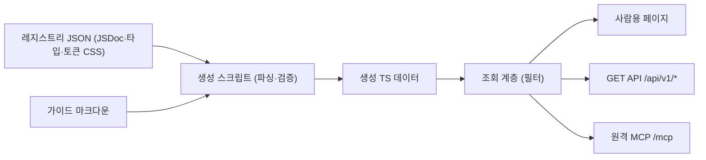

# 문서 앱 구조

`apps/docs`는 하나의 Next.js App Router 앱에서 사람용 문서 페이지, GET API, 원격 MCP를 함께 제공해요. 세 출력은 같은 문서 원본에서 만든 데이터만 읽어요. 이를 통해 페이지와 에이전트가 보는 내용이 어긋나지 않아요.

목표는 Claude Code 같은 에이전트가 문서 HTML 전체를 읽지 않고, 필요한 컴포넌트의 필요한 섹션만 조회하게 하는 것이에요.

## 데이터 흐름



## 폴더 구조

프론트 영역과 백엔드 영역을 나누고, 두 영역이 함께 읽는 문서 데이터는 공용 영역에 둬요.

```text
apps/docs/
├── app/                      # Next.js 라우팅 진입점
│   ├── layout.tsx, page.tsx  # 프론트 라우트
│   ├── api/v1/               # 백엔드 라우트: GET Route Handler
│   └── mcp/                  # 백엔드 라우트: 원격 MCP 엔드포인트
├── frontend/                 # 프론트 영역: 사람용 페이지 UI
├── backend/                  # 백엔드 영역
│   ├── api/                  # GET API 파라미터 검증·응답 구성
│   └── mcp/                  # MCP 서버와 도구 정의
├── content/                  # 공용 영역: 문서 데이터
│   ├── source/
│   │   ├── guides/           # 설치·폰트 설정 같은 공통 가이드 원본 (아직 없어요)
│   │   └── versions.json     # 함께 쓸 수 있는 가장 낮은 하네스 버전
│   ├── schema.ts             # 문서 데이터 타입과 섹션 키·분류
│   ├── query.ts              # 목록·단건·섹션·props·토큰·검색 조회 함수
│   └── generated/            # 생성 결과, Git에 포함하지 않아요
└── scripts/                  # 레지스트리 JSON → TS 데이터 생성 스크립트
```

- `app/`에는 라우트 파일만 둬요. 라우트 파일은 `frontend/`나 `backend/`의 코드를 불러와 연결만 해요.
- `frontend/`와 `backend/`는 `content/`에만 의존해요. 두 영역은 서로 import하지 않아요.
- `content/`는 `frontend/`와 `backend/`를 import하지 않아요.
- `frontend/`는 `pages`, `features`, `layouts`, `shared`로 역할을 나눠요. 페이지 조립, 코드 배치와 Server·Client Component 기준은 [문서 프론트엔드 지침](docs-frontend.md)에서 관리해요.

## 원본은 레지스트리 JSON이에요

- 컴포넌트 문서를 따로 쓰지 않아요. 레지스트리 JSON에 담긴 소스의 JSDoc에서 설명과 섹션을 추출해요. JSDoc의 `###` 제목은 데이터의 섹션 키와 1:1로 대응해요.
- 생성 스크립트는 `schema.ts` 타입을 만족하는 TS 데이터를 만들어요. `pnpm dev:docs`·`pnpm build:docs`가 먼저 실행해요.
- 검증은 엄격하게 해요. JSDoc 설명이나 props 타입이 없거나 정해지지 않은 제목이 있으면 생성을 실패시켜요.
- props는 직접 쓰지 않아요. 같은 JSON의 TypeScript 타입 선언에서 추출해요. 직접 쓴 props는 구현과 쉽게 어긋나고, 틀린 props는 에이전트가 잘못된 코드를 쓰게 만들어요.
- 토큰도 직접 쓰지 않아요. 레지스트리 `tokens` 항목의 CSS 파일에서 추출해요.
- 가이드만 `content/source/guides/`에 마크다운으로 써요.
- 전달받지 않은 컴포넌트 명세와 디자인 값을 문서에 임의로 쓰지 않아요.

JSDoc과 섹션 키의 대응, 가이드 주제와 각 가이드가 담아야 하는 내용은 [원격 MCP 규격](mcp-spec.md#콘텐츠)에서 관리해요.

## 조회 계층을 하나로 둬요

페이지, GET API, MCP는 모두 `content/query.ts`의 같은 함수를 호출해요. MCP는 같은 앱에 있으므로 자기 GET API를 HTTP로 다시 호출하지 않아요. 필터 규칙은 이 계층 한 곳에서 관리해요.

## API와 MCP 도구를 작게 나눠요

도구 설명도 에이전트의 컨텍스트를 차지해요. 그래서 도구 수는 적게 두고 필터는 파라미터로 받아요. 응답에는 요청한 부분만 담아요.

도구 목록·GET API 대응·입력과 응답 형식·오류 응답·도구 설명·구현 순서는 [원격 MCP 규격](mcp-spec.md#도구)에서만 관리해요. 목록이나 개수를 이 문서에 복제하지 않아요.

## 사용 의미와 설치 데이터를 연결해요

사람용 문서와 MCP는 같은 사용 목적·선택 기준·조합 규칙을 읽어요. Props·토큰은 코드에서 추출하고, 설치할 파일은 레지스트리를 기준으로 확인해요. 설치 규격을 문서 원본에 다시 작성하지 않아요.

원격 문서의 컴포넌트는 레지스트리 항목에서 만들어지므로 항목 `id`와 `entry`를 그대로 알려줘요. 하네스는 문서로 사용할 UI를 선택하고 실제 설치 기록으로 사용 경로를 확인해요. 경계와 기준 정보는 [레지스트리 연동 계약](registry.md#하네스가-소비-방식을-구분하게-해요)을 따라요. 서버는 소비 프로젝트의 파일 위치를 모르는 상태에서 로컬 import 경로를 만들어 주지 않아요.

## 원격 MCP를 연결해요

`backend/mcp/server.ts`에서 `mcp-handler`와 `@modelcontextprotocol/server`로 MCP 서버를 정의하고, `app/mcp/route.ts`에서 GET·POST로 연결해요. 서버는 세션 없이 동작해서 별도 저장소가 필요 없어요.

```bash
pnpm dev:docs
claude mcp add --transport http eli-docs http://localhost:3000/mcp
```

도구는 `registerTool`로 등록하고 입력의 타입은 zod로 검증해요. 허용 값 검사와 오류 형식은 조회 계층이 맡아요. 모든 도구에 `annotations: { readOnlyHint: true }`를 지정해요.

## 정하지 않은 것

- **배포 설정:** Cloudflare Workers에 OpenNext 어댑터로 올리고 `eli-design.dev`에 연결해요. 원격 MCP의 주소는 `https://eli-design.dev/mcp`예요. 설정과 확인 방법은 [배포 검증](testing.md#문서-앱-배포를-확인해요)을 따라요.
- **압축 응답 형식:** TOON 같은 압축 형식은 실제 응답으로 토큰 수를 측정해 효과가 확인되면 추가해요.
- **문서 버전:** npm 배포는 시작했지만 버전별 문서 조회는 아직 구현하지 않았어요. 문서 앱을 공개할 때 설명 대상인 게시 버전을 명시하고, 설치 버전과 다르면 차이를 안내해요. `0.x`·정식 릴리스의 운영 기준은 [버전 규칙](versioning.md)을 따라요.

조회 계층과 MCP 도구는 구현되어 있어요. 사람용 문서 페이지·GET API·가이드 원본·배포는 아직 없어요. 현재 상태는 [원격 MCP 규격](mcp-spec.md#구현-상태)에서 관리해요.
