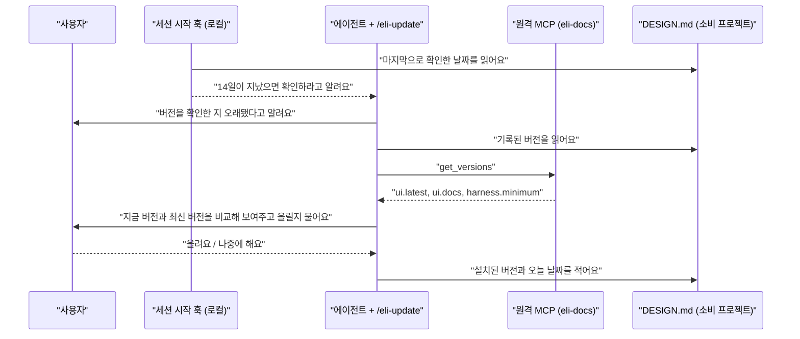

# 원격 MCP 규격

`apps/docs`의 `/mcp`에서 제공할 원격 MCP 서버 `eli-docs`의 규격이에요. 이 문서대로 구현해요. 아직 구현되지 않았어요. 현재는 엔드포인트만 있고 등록된 도구가 없어요.

문서 원본의 위치, 폴더 구조, 조회 계층은 [문서 앱 지침](docs.md)에서 관리해요. 이 서버를 쓰는 쪽의 규칙은 [하네스 지침](harness.md)에서 관리해요.

## 역할

원격 MCP는 ELI 자체의 정보만 제공해요. 컴포넌트를 언제 어떻게 쓰는지, props, 토큰, 설치 방법이에요. 에이전트가 문서 HTML 전체를 읽지 않고 필요한 부분만 조회하게 하는 것이 목표예요.

| 제공해요 | 제공하지 않아요 |
| --- | --- |
| 컴포넌트 문서, props, 토큰 | 소비 프로젝트의 `DESIGN.md`·`ICON.md`·`UX-WRITING.md` 초안 (하네스에 있어요) |
| 설치·폰트·점검·아이콘 가이드 | CSS·React 일반 기준 (하네스에 있어요) |
| 문서 검색 | 파일 쓰기, 설치 실행 같은 변경 작업 |

## 서버

| 항목 | 값 |
| --- | --- |
| 서버 이름 | `eli-docs` |
| 서버 버전 | `@eli-design/ui`의 `version`과 같게 둬요 |
| 엔드포인트 | `/mcp` 하나 (GET, POST) |
| 전송 방식 | Streamable HTTP |
| 세션 | 없어요. 요청마다 독립적으로 처리해요 |
| 인증 | 없어요 |
| 도메인 | 아직 정하지 않았어요 |
| 배포 | Cloudflare (OpenNext 어댑터 필요, 아직 설정하지 않았어요) |
| 로컬 주소 | `http://localhost:3000/mcp` (`pnpm dev:docs`) |

구현 위치는 `apps/docs/backend/mcp/server.ts`예요. `mcp-handler`의 `createMcpHandler` 안에서 `registerTool`로 도구를 등록하고, 입력은 zod로 검증해요.

## 공통 규칙

- 모든 도구는 읽기 전용이에요. 모든 도구에 `annotations: { readOnlyHint: true }`를 지정해요.
- 도구는 `content/query.ts`의 조회 함수만 호출해요. 자기 GET API를 HTTP로 다시 호출하지 않아요.
- 응답은 JSON 문자열을 담은 텍스트 콘텐츠 하나예요. 들여쓰기 없이 직렬화해요.
- 응답에는 요청한 부분만 담아요. 요청하지 않은 섹션이나 prop을 함께 주지 않아요.
- 값이 없는 필드는 빼지 않고 `null`로 줘요. 에이전트가 "없음"과 "빠뜨림"을 구분할 수 있어야 해요.
- 컴포넌트 이름과 가이드 주제는 대소문자를 구분하지 않고 찾아요. 응답에는 정식 표기로 줘요.
- 문서 내용은 배포 단위로만 바뀌어요. 실행 중에 바뀌는 상태를 두지 않아요.

### 오류

오류는 `isError: true`와 아래 JSON을 텍스트 콘텐츠로 돌려줘요. 예외를 던지지 않아요.

```json
{ "error": { "code": "not_found", "message": "컴포넌트 'Buton'을 찾을 수 없어요.", "allowed": ["Button", "IconButton"] } }
```

| `code` | 언제 | `allowed` |
| --- | --- | --- |
| `not_found` | 없는 컴포넌트 이름이나 가이드 주제 | 이름이 비슷한 후보를 다섯 개까지. 후보가 없으면 전체 목록 |
| `invalid_argument` | 허용하지 않는 섹션 키, 분류, 상태, 범위를 벗어난 숫자 | 허용하는 값 전체 |

- `message`는 한국어로 쓰고, 무엇이 틀렸는지 한 문장으로 알려요.
- 에이전트가 다시 추측하지 않고 `allowed`에서 골라 바로 다시 호출할 수 있어야 해요.
- 스택 트레이스, 파일 경로, 내부 오류 메시지를 응답에 담지 않아요.

## 도구

도구는 일곱 개예요. 도구 설명도 에이전트의 컨텍스트를 차지하므로 늘리지 않아요. 새 기능은 기존 도구의 파라미터로 먼저 검토해요.

`description`은 아래 문구를 그대로 등록해요. 에이전트는 이 문구를 보고 어느 도구를 부를지 정해요.

### `list_components`

- **설명:** `ELI 컴포넌트의 목록을 돌려줘요. 어떤 컴포넌트가 있는지 찾을 때 가장 먼저 써요. 사용법은 get_component로 읽어요.`
- **GET API:** `/api/v1/components?group=&status=`

| 입력 | 타입 | 필수 | 설명 |
| --- | --- | --- | --- |
| `group` | 문자열 | 선택 | `packages/ui/package.json`의 `exports` 경로 이름 (예: `button`) |
| `status` | `stable` \| `draft` | 선택 | 문서의 상태 |

```json
{
  "components": [
    { "name": "Button", "group": "button", "description": "아이콘과 텍스트를 함께 표시하는 버튼", "status": "stable", "import": "@eli-design/ui/button" },
    { "name": "IconButton", "group": "button", "description": "…", "status": "stable", "import": "@eli-design/ui/button" }
  ]
}
```

- 이름순으로 정렬해요.
- `import`는 `@eli-design/ui/` 뒤에 `group`을 붙인 경로예요.
- 조건에 맞는 컴포넌트가 없으면 오류가 아니라 빈 배열을 줘요.
- 없는 `group`은 `invalid_argument`예요.

### `get_component`

- **설명:** `컴포넌트 하나의 문서를 섹션 단위로 돌려줘요. 어떤 컴포넌트를 쓸지 고를 때는 when-to-use, 코드를 쓸 때는 examples를 요청해요. props는 get_props로 읽어요.`
- **GET API:** `/api/v1/components/{name}?sections=`

| 입력 | 타입 | 필수 | 설명 |
| --- | --- | --- | --- |
| `name` | 문자열 | 필수 | 컴포넌트 이름 (예: `Button`) |
| `sections` | 섹션 키 배열 | 선택 | 생략하면 `summary`, `when-to-use` |

섹션 키는 `summary`, `when-to-use`, `examples`, `variants`, `do-dont`, `accessibility`, `related`예요.

```json
{
  "name": "Button",
  "group": "button",
  "import": "@eli-design/ui/button",
  "status": "stable",
  "sections": {
    "summary": "…마크다운…",
    "when-to-use": "…마크다운…"
  },
  "available": ["summary", "when-to-use", "examples", "variants", "do-dont"]
}
```

- `sections`의 값은 원본 마크다운 그대로예요. 섹션 제목(`##`)은 빼요.
- 요청한 선택 섹션이 문서에 없으면 그 키를 `sections`에서 빼요. 오류가 아니에요.
- `available`은 이 문서에 실제로 있는 섹션 키예요. 에이전트가 없는 섹션을 다시 요청하지 않게 해요.
- 허용하지 않는 섹션 키는 `invalid_argument`예요.

### `get_props`

- **설명:** `컴포넌트의 props를 타입, 필수 여부, 기본값, 설명과 함께 돌려줘요. 코드에 props를 쓰기 전에 확인해요.`
- **GET API:** `/api/v1/components/{name}/props?names=`

| 입력 | 타입 | 필수 | 설명 |
| --- | --- | --- | --- |
| `name` | 문자열 | 필수 | 컴포넌트 이름 |
| `names` | 문자열 배열 | 선택 | 생략하면 모든 prop |

```json
{
  "name": "Button",
  "props": [
    { "name": "variant", "type": "\"solid\" | \"outline\" | \"ghost\"", "required": false, "default": "\"solid\"", "description": "버튼 모양" },
    { "name": "onClick", "type": "…", "required": false, "default": null, "description": "버튼을 눌렀을 때 실행할 함수" }
  ]
}
```

- props는 `packages/ui`의 TypeScript 타입에서 추출해요. 마크다운에 직접 쓰지 않아요.
- `type`은 타입을 풀어 쓴 문자열이에요. 유니언은 모든 값을 보여줘요.
- `description`은 prop의 JSDoc에서, `default`는 JSDoc의 `@default`에서 가져와요. 없으면 `null`이에요.
- 컴포넌트가 직접 정의한 props만 담아요. HTML 요소에서 물려받은 속성(`aria-*`, `onKeyDown` 등)은 담지 않고, 물려받는 요소를 `extends` 필드에 문자열로 알려줘요. 예: `"extends": "button"`. 물려받지 않으면 `null`이에요.
- `names`에 없는 prop 이름이 있으면 `invalid_argument`이고, `allowed`에 그 컴포넌트의 prop 이름을 줘요.

### `search`

- **설명:** `컴포넌트 문서와 가이드에서 낱말을 찾아요. 필요한 컴포넌트의 이름을 모를 때 써요. 결과의 id로 get_component나 get_guide를 불러요.`
- **GET API:** `/api/v1/search?q=&limit=`

| 입력 | 타입 | 필수 | 설명 |
| --- | --- | --- | --- |
| `q` | 문자열 | 필수 | 2자 이상 100자 이하 |
| `limit` | 정수 | 선택 | 기본 5, 1 이상 20 이하 |

```json
{
  "results": [
    { "id": "Button", "kind": "component", "title": "Button", "section": "when-to-use", "excerpt": "…일치한 부분의 앞뒤…" },
    { "id": "install", "kind": "guide", "title": "설치", "section": null, "excerpt": "…" }
  ]
}
```

- `kind`는 `component` 또는 `guide`예요. `id`는 `get_component`의 `name`이나 `get_guide`의 `topic`으로 바로 쓸 수 있어요.
- `section`은 일치한 섹션 키예요. 가이드이거나 이름·설명에서 일치했으면 `null`이에요.
- `excerpt`는 200자 이하예요. 본문 전체를 주지 않아요.
- 대소문자를 구분하지 않고 부분 일치로 찾아요. 띄어쓰기로 나눈 낱말이 모두 들어 있는 문서를 찾아요.
- 순서는 이름에서 일치, 설명에서 일치, 본문에서 일치 순이에요. 한 문서는 결과에 한 번만 나와요.
- 일치하는 문서가 없으면 오류가 아니라 빈 배열을 줘요.
- 검색 색인은 빌드할 때 만들어요. 외부 검색 서비스를 쓰지 않아요.

### `get_tokens`

- **설명:** `ELI 디자인 토큰을 분류별로 돌려줘요. 색, 글자, 간격 값이 필요할 때 써요. 값을 기억으로 쓰지 않고 여기서 확인해요.`
- **GET API:** `/api/v1/tokens?category=`

| 입력 | 타입 | 필수 | 설명 |
| --- | --- | --- | --- |
| `category` | `color` \| `semantic-color` \| `typography` \| `layout` | 필수 | 토큰 분류 |

```json
{
  "category": "layout",
  "tokens": [
    { "name": "--eli-layout-scale-4", "value": "16px", "group": "Scale", "description": null },
    { "name": "--eli-layout-breakpoint-tablet", "value": "768px", "group": "Responsive", "description": null }
  ]
}
```

토큰은 `packages/ui/src/tokens`의 CSS 파일에서 추출해요. 마크다운에 직접 쓰지 않아요.

| `category` | 원본 파일 |
| --- | --- |
| `color` | `colors.css` |
| `semantic-color` | `semantic-colors.css` |
| `typography` | `typography.css` |
| `layout` | `layout.css` |

- `name`은 CSS 변수 이름, `value`는 선언된 값 그대로예요. 다른 변수를 가리키면 `var(...)` 그대로 줘요.
- `group`은 그 선언 위의 가장 가까운 구역 주석이에요. 없으면 `null`이에요.
- `description`은 선언과 같은 줄에 있는 주석이에요. 없으면 `null`이에요.
- 파일에 선언된 순서대로 줘요.
- 토큰 파일이 추가되면 분류를 함께 추가해요.

### `get_guide`

- **설명:** `설치, 폰트 설정, 디자인 시스템 페이지 구성, 점검 규칙, 아이콘 규칙 같은 공통 가이드를 돌려줘요. topic을 생략하면 가이드 목록을 돌려줘요.`
- **GET API:** `/api/v1/guides`, `/api/v1/guides/{topic}`

| 입력 | 타입 | 필수 | 설명 |
| --- | --- | --- | --- |
| `topic` | 문자열 | 선택 | 생략하면 목록 |

```json
{ "topic": "install", "title": "설치", "description": "프레임워크와 패키지 매니저별 설치 방법", "body": "…마크다운…" }
```

```json
{ "guides": [{ "topic": "install", "title": "설치", "description": "프레임워크와 패키지 매니저별 설치 방법" }] }
```

- `body`는 원본 마크다운 그대로예요.
- 가이드는 통째로 줘요. 한 가이드가 한 번에 읽기에 길어지면 주제를 나눠요.

### `get_versions`

- **설명:** `게시된 @eli-design/ui의 최신 버전과 이 서버가 지원하는 가장 낮은 스킬 버전을 돌려줘요. 프로젝트가 쓰는 버전이 최신인지 확인할 때 써요.`
- **GET API:** `/api/v1/versions`

입력은 없어요.

```json
{
  "ui": { "latest": "0.2.0", "docs": "0.2.0" },
  "harness": { "minimum": "0.1.0" }
}
```

| 필드 | 뜻 | 가져오는 곳 |
| --- | --- | --- |
| `ui.latest` | npm에 게시된 `@eli-design/ui`의 최신 버전 | 빌드할 때의 `packages/ui/package.json`의 `version` |
| `ui.docs` | 이 서버의 문서가 설명하는 `@eli-design/ui`의 버전 | 같은 값. 문서를 버전별로 제공하게 되면 달라질 수 있어요 |
| `harness.minimum` | 이 서버와 함께 쓸 수 있는 가장 낮은 스킬 버전 | `content/`에 직접 적어요 |

- 스킬과 훅은 `@eli-design/ui` 패키지에 함께 들어 있어서 버전이 같아요. 그래서 하네스의 최신 버전은 따로 없고 `ui.latest`가 곧 최신 스킬 버전이에요.
- 서버는 버전만 알려줘요. 내려받을 주소나 설치 명령을 응답에 담지 않아요. 하네스는 원격이 알려준 주소에서 코드를 받지 않고, 설치된 패키지 안의 파일을 복사해요.
- 도구 이름, 입력, 응답 형식, 섹션 키, 가이드 주제를 호환되지 않게 바꾸면 `harness.minimum`을 그 변경을 지원하는 `@eli-design/ui` 버전으로 올려요.
- 아직 npm에 게시하지 않은 버전을 `ui.latest`로 내보내지 않아요. 게시한 뒤에 문서 앱을 배포해요.
- 값은 빌드할 때 정해져요. 실행 중에 npm에 묻지 않아요.

## 콘텐츠

도구가 돌려주는 내용의 형식이에요. 원본은 `apps/docs/content/source/`에 마크다운으로 써요.

### 컴포넌트 문서

`content/source/components/`에 컴포넌트마다 파일 하나를 써요. 파일 이름은 컴포넌트 이름을 소문자와 하이픈으로 바꾼 것이에요. 예: `Button`은 `button.md`, `IconButton`은 `icon-button.md`.

| frontmatter | 값 | 필수 |
| --- | --- | --- |
| `name` | `packages/ui`가 내보내는 컴포넌트 이름 | 필수 |
| `group` | `exports` 경로 이름 | 필수 |
| `description` | 한 줄 설명. 마침표 없이 써요 | 필수 |
| `status` | `stable` 또는 `draft` | 필수 |

| 섹션 키 | 담는 내용 | 필수 |
| --- | --- | --- |
| `summary` | 무엇을 하는 컴포넌트인지 두세 문장 | 필수 |
| `when-to-use` | 언제 쓰고 언제 쓰지 않는지. 쓰지 않을 때 대신 쓸 컴포넌트 | 필수 |
| `examples` | 복사해서 쓸 수 있는 코드. import 문을 포함해요 | 필수 |
| `variants` | 크기·색상·상태 같은 변형과 고르는 기준 | 선택 |
| `do-dont` | 권장하는 사용법과 피해야 할 사용법. `/eli-verify`가 점검 기준으로 읽어요 | 선택 |
| `accessibility` | 키보드 동작, 스크린 리더, 필요한 라벨 | 선택 |
| `related` | 함께 쓰거나 헷갈리기 쉬운 컴포넌트 | 선택 |

- `##` 제목에는 섹션 키를 그대로 써요. 사람용 페이지는 한국어 라벨로 바꿔 보여줘요.
- 전달받지 않은 컴포넌트 명세와 디자인 기준을 지어내지 않아요. 디자이너와 합의하지 않은 내용은 섹션을 비워 두고 `status`를 `draft`로 둬요.
- `examples`의 코드는 실제로 타입 검사를 통과해야 해요.
- `do-dont`는 항목마다 "이렇게 해요"와 "이렇게 하지 않아요"를 한 쌍으로 쓰고, 코드로 확인할 수 있게 구체적으로 써요.

### 가이드

`content/source/guides/{topic}.md`에 frontmatter `title`, `description`과 마크다운 본문으로 써요. 주제는 아래 다섯 개만 허용해요. 하네스의 스킬이 이 내용을 읽고 동작하므로, 각 가이드는 "담아야 하는 것"을 모두 담아야 해요.

| 주제 | 읽는 명령 | 담아야 하는 것 |
| --- | --- | --- |
| `install` | 기본 동작, `/eli-design-system`, `/eli-doctor` | 지원하는 프레임워크와 버전, 패키지 매니저별 설치 명령, 필요한 peer dependency, 별도 CSS import가 필요 없다는 것, 설치가 끝났는지 확인하는 방법 |
| `font` | `/eli-design-system` | ELI 컴포넌트의 글꼴을 프로젝트가 고른 글꼴로 바꾸는 방법(`--eli-font-family-sans`), ELI가 쓰는 굵기와 그 글꼴이 갖춰야 하는 조건. 어떤 글꼴을 고를지는 하네스의 `fonts.md`가 다뤄요 |
| `design-system-page` | `/eli-design-system`, `/eli-setup` | 페이지의 구역과 순서, 구역마다 보여줄 것, 토큰과 컴포넌트를 보여주는 방식 |
| `verify` | `/eli-verify` | 점검 규칙과 예외, 네이티브 요소와 ELI 컴포넌트의 대응 표, 하네스의 기본 기준보다 엄격하게 볼 값 |
| `icon` | `/eli-icon` | 커스텀 아이콘의 캔버스, 선 굵기, 모서리, 색 규칙. `ICON.md` 초안의 기본값보다 먼저 적용돼요 |

- `icon` 가이드는 디자이너에게 규칙을 전달받은 뒤에 써요. 그 전에는 주제를 만들지 않아요. 없는 주제를 요청하면 `not_found`가 돌아가고, 하네스는 초안의 기본값을 써요.
- `verify` 가이드의 대응 표는 "어떤 네이티브 요소나 자체 구현을 어떤 ELI 컴포넌트로 바꾸는지"를 적어요.

### 빌드와 검증

빌드 스크립트가 원본을 읽어 `content/generated/`의 TS 데이터로 만들어요. 아래 경우에는 빌드를 실패시켜요.

- 필수 frontmatter나 필수 섹션이 없어요.
- 허용하지 않는 섹션 키나 가이드 주제가 있어요.
- `name`이 `packages/ui`가 내보내는 컴포넌트가 아니에요.
- `group`이 `packages/ui/package.json`의 `exports`에 없어요.
- 같은 `name`이 두 번 나와요.

`packages/ui`가 내보내는 컴포넌트 중 문서가 없는 것은 실패가 아니라 경고로 알려요.

## 하네스와의 계약

하네스의 스킬은 아래 이름을 그대로 써요. 이름이나 형식을 바꾸면 `packages/harness`의 스킬을 같은 변경에서 함께 고쳐요.

| 하네스가 쓰는 곳 | 의존하는 것 |
| --- | --- |
| 세션 시작 훅, `eli` 스킬 | 서버 이름 `eli-docs`, 도구 이름 일곱 개, 섹션 키 `when-to-use`·`examples` |
| `/eli-design-system`, `/eli-setup` | `get_tokens`의 분류 네 개, `get_component`의 `examples`·`variants`, 가이드 `install`·`font`·`design-system-page`, CSS 변수 `--eli-font-family-sans` |
| `/eli-verify` | `list_components`, `get_tokens`, 섹션 `do-dont`, 가이드 `verify` |
| `/eli-doctor` | `list_components`가 응답하는지(연결 확인), 가이드 `install`, `get_versions` |
| `/eli-update`, `/eli-setup` | `get_versions`의 `ui.latest`·`ui.docs`·`harness.minimum`, 가이드 `install` |
| `/eli-icon` | `search`, 가이드 `icon` |

## 버전 알림의 흐름

하네스는 소비 프로젝트가 쓰는 버전이 오래되면 사용자에게 알려요. 원격 서버는 이 흐름에서 "지금 최신 버전이 무엇인지"를 답하는 역할을 맡아요. 서버를 구현할 때 이 흐름을 기준으로 `get_versions`가 무엇을 보장해야 하는지 확인해요.



### 누가 무엇을 하나요

| 단계 | 맡는 곳 | 하는 일 |
| --- | --- | --- |
| 기록 | 소비 프로젝트의 `DESIGN.md` | `## 버전`에 쓰는 `@eli-design/ui` 버전, 복사한 스킬의 버전, 마지막으로 확인한 날짜를 적어요 |
| 알림 | 세션 시작 훅 | 날짜를 읽어 14일이 지났거나 기록이 없으면 알려요. 설치된 패키지와 복사한 스킬의 버전이 다른 것도 알려요. 네트워크를 쓰지 않아요 |
| 확인 | `/eli-update` | `get_versions`를 불러 설치된 버전과 비교해요 |
| 답 | 원격 MCP | 최신 버전과 최소 하네스 버전을 돌려줘요 |
| 올리기 | `/eli-update` | 사용자에게 확인받은 뒤 패키지 매니저로 `@eli-design/ui`를 올리고, 패키지 안의 스킬과 훅을 프로젝트로 다시 복사해요 |

서버는 알림을 보내지 않아요. 푸시, 웹훅, 구독 같은 기능을 만들지 않아요. 알림은 로컬의 훅이 날짜를 보고 시작하고, 서버는 물어봤을 때 답하기만 해요.

### 하네스가 응답을 해석하는 방법

`/eli-update`는 `get_versions`의 응답을 아래처럼 읽어요. 서버의 값이 틀리면 사용자에게 틀린 안내가 나가요.

| 조건 | 하네스가 사용자에게 알리는 것 |
| --- | --- |
| 설치된 `@eli-design/ui`가 `ui.latest`와 같아요 | 최신이에요. 날짜만 갱신해요 |
| 설치된 `@eli-design/ui`가 `ui.latest`보다 낮아요 | 새 버전이 있어요. 올릴지 물어요 |
| 설치된 `@eli-design/ui`가 `ui.docs`와 달라요 | 문서의 props가 설치된 버전과 다를 수 있어요 |
| 복사한 스킬이 `harness.minimum`보다 낮아요 | 반드시 올려야 해요. 다른 작업보다 먼저 올리자고 해요 |
| 서버에 연결할 수 없거나 오류가 돌아와요 | 확인하지 못했어요. 날짜를 갱신하지 않아요 |

버전은 SemVer로 비교해요. 그래서 세 값은 모두 `1.2.3` 형식의 온전한 버전이어야 해요. `latest`, `^0.2.0`, `v0.2.0` 같은 값을 돌려주지 않아요.

### 서버가 지켜야 하는 것

- **게시한 뒤에 배포해요.** `ui.latest`에는 npm에 실제로 게시된 버전만 내보내요. 게시 전에 문서 앱을 먼저 배포하면 하네스가 설치할 수 없는 버전을 올리라고 안내해요. 릴리스 순서는 npm 게시, 그다음 문서 앱 배포예요.
- **값을 빌드할 때 정해요.** `ui.latest`는 `packages/ui/package.json`에서 읽어요. 실행 중에 npm이나 GitHub에 묻지 않아요. 외부 서비스가 느리거나 죽어도 답할 수 있어야 해요.
- **`harness.minimum`은 사람이 올려요.** 도구 이름, 입력, 응답 형식, 섹션 키, 가이드 주제를 예전 하네스가 쓸 수 없게 바꿀 때만 올려요. 호환되는 추가(새 선택 필드, 새 가이드 주제)에는 올리지 않아요. 필요 없이 올리면 모든 사용자에게 "반드시 올려야 해요"가 나가요.
- **`harness.minimum`은 `ui.latest`보다 높을 수 없어요.** 빌드할 때 검사해서 어기면 빌드를 실패시켜요.
- **응답에 주소나 명령을 담지 않아요.** 내려받을 주소, 설치 명령, 스크립트를 넣지 않아요. 하네스는 서버가 알려준 곳에서 코드를 받지 않아요. 서버나 도메인이 뚫려도 사용자의 컴퓨터에서 코드가 실행되는 통로가 되지 않게 하기 위해서예요.
- **입력 없이 항상 같은 형식으로 답해요.** 이 도구는 프로젝트의 버전을 받지 않아요. 비교는 하네스가 해요. 서버가 사용자의 버전을 알 필요가 없고, 기록하지도 않아요.
- **예전 하네스도 이 도구를 부를 수 있어야 해요.** `get_versions`의 이름과 세 필드는 바꾸지 않아요. 이 도구가 깨지면 예전 하네스는 자신이 낡았다는 것을 알 방법이 없어요. 필드를 더할 수는 있지만 빼거나 이름을 바꾸지 않아요.

### 확인하는 간격

| 값 | 정하는 곳 | 지금 값 |
| --- | --- | --- |
| 알림 기준 | 하네스의 `packages/harness/hooks/session-start.mjs`의 `STALE_DAYS` | 14일 |

서버는 간격을 정하지 않아요. 한 프로젝트는 많아야 14일에 한 번 `get_versions`를 불러요. 사용자가 `/eli-update`나 `/eli-doctor`를 직접 실행하면 그때도 불러요.

### 구현할 때 확인해요

- `get_versions`가 세 필드를 모두 온전한 SemVer 문자열로 돌려줘요.
- `packages/ui/package.json`의 버전을 올리고 다시 빌드하면 `ui.latest`가 바뀌어요.
- `harness.minimum`이 `ui.latest`보다 높으면 빌드가 실패해요.
- GET API `/api/v1/versions`가 같은 내용을 돌려줘요.
- 하네스의 `/eli-update`로 "최신이에요", "새 버전이 있어요", "반드시 올려야 해요" 세 경우를 실제로 확인해요.

## 구현 순서

1. `content/schema.ts`: 컴포넌트, 섹션 키, 가이드 주제, 토큰, prop의 타입
2. 빌드 스크립트: 마크다운 파싱과 검증, props 추출, 토큰 추출, 검색 색인
3. `content/query.ts`: 목록, 단건, 섹션, props, 토큰, 가이드, 검색 조회 함수
4. GET API: `app/api/v1/`의 Route Handler. 빌드할 때 정적으로 만들어요
5. MCP 도구: `backend/mcp/server.ts`에 일곱 개 등록
6. 문서 원본: 가이드 `install`·`font`와 컴포넌트 문서 하나로 시작해요
7. Cloudflare 배포와 도메인 연결

### 완료 기준

- 도구 일곱 개가 이 문서의 입력과 응답 형식대로 동작해요.
- 없는 이름과 허용하지 않는 값에 `allowed`가 담긴 오류를 돌려줘요.
- 같은 조회에 MCP 도구와 GET API가 같은 내용을 돌려줘요.
- 빌드 검증이 위의 다섯 경우를 실패시켜요.
- 조회 함수와 오류 응답에 자동 검사가 있어요.
- 로컬에서 `claude mcp add --transport http eli-docs http://localhost:3000/mcp`로 연결해 여섯 도구를 실제로 불러 확인해요.
- 하네스의 `/eli-doctor`가 원격 연결 항목을 통과로 보고해요.

## 정하지 않은 것

- **도메인:** 정해지면 이 문서와 `packages/harness/skills/eli/SKILL.md`의 주소를 함께 고쳐요.
- **버전별 문서:** npm 배포 전이라 최신 문서 하나만 제공해요. 배포를 시작하면 버전별 조회가 필요한지 검토해요.
- **변경 내역 도구:** 버전 사이에 바뀐 props와 토큰을 알려주는 도구는 첫 배포 뒤에 검토해요. 그 전에는 `/eli-update`가 패키지의 변경 내역과 타입 검사로 확인해요.
- **압축 응답 형식:** 실제 응답으로 토큰 수를 측정해 효과가 확인되면 추가해요.
- **사용량 제한:** 인증이 없으므로 남용을 막을 방법이 필요할 수 있어요. 배포할 때 Cloudflare의 설정으로 검토해요.
