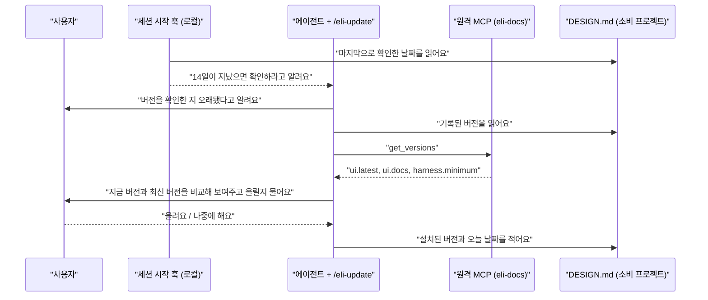

# 원격 MCP 규격

`apps/docs`의 `/mcp`에서 제공하는 원격 MCP 서버 `eli-docs`의 규격이에요. 도구 일곱 개와 조회 계층은 구현되어 있고 로컬에서 동작해요. `https://eli-design.dev/mcp`에 배포되어 있어요. GET API와 가이드 원본은 아직 없어요. 응답은 소스 설치 방식을 기준으로 해요.

컴포넌트의 사용 기준(섹션)은 검토한 [컴포넌트 가이드 JSON](../apps/docs/content/components)에서, props·토큰·설치 정보는 [레지스트리](registry.md)의 목록·항목 JSON에서 만들어요. 가이드는 사람이 검토하는 자료이고 props·토큰은 코드에서 추출해요. 같은 내용을 두 곳에 복제하지 않아요.

문서 원본의 위치, 폴더 구조, 조회 계층은 [문서 앱 지침](docs.md)에서 관리해요. 이 서버를 쓰는 쪽의 규칙은 [하네스 지침](harness.md)에서 관리해요.

## 역할

원격 MCP는 ELI 자체의 정보만 제공해요. 컴포넌트를 언제 어떻게 쓰는지, props, 토큰, 설치 방법이에요. 에이전트가 문서 HTML 전체를 읽지 않고 필요한 부분만 조회하게 하는 것이 목표예요.

| 제공해요 | 제공하지 않아요 |
| --- | --- |
| 컴포넌트 문서, props, 토큰 | 소비 프로젝트의 `DESIGN.md`·`ICON.md`·`UX-WRITING.md` 초안 (하네스에 있어요) |
| 설치·폰트·점검·아이콘 가이드 | CSS·React 일반 기준 (하네스에 있어요) |
| 문서 검색 | 파일 쓰기, 설치 실행 같은 변경 작업 |

## 서버

### 소스 설치를 기준으로 답해요

- 응답은 종료 예정인 `@eli-design/ui`의 그룹 import 경로를 주지 않아요. 레지스트리 항목 `id`와 `entry`(설치 위치 기준 진입 파일·export 이름)를 줘요.
- 서버는 소비 프로젝트의 파일 위치를 몰라요. 실제 import 경로는 하네스가 소비 프로젝트의 설치 기록에 `entry.path`를 연결해 만들어요.
- 사용 목적·선택 기준은 컴포넌트 가이드 JSON이 원본이에요. 레지스트리에 수동으로 복제하지 않아요.
- 서버 버전·`ui.latest`·`ui.docs`·`harness.minimum`의 역할은 [버전 기준](versioning.md#설치-도구와-콘텐츠-버전을-구분해요)에 맞춰 구분해요. 설치 도구의 npm `latest`를 UI 콘텐츠나 하네스 버전으로 대신하지 않아요.
- 설치는 읽기 전용 MCP가 실행하지 않아요. 신뢰하는 설치 도구의 비대화형 호출·결과 처리는 [레지스트리 계약](registry.md#하네스가-설치-도구를-호출해요)을 따라요.

### 서버 설정

| 항목 | 값 |
| --- | --- |
| 서버 이름 | `eli-docs` |
| 서버 버전 | 데이터를 만든 UI 콘텐츠(레지스트리)의 `version`과 같게 둬요 |
| 엔드포인트 | `/mcp` 하나 (GET, POST) |
| 전송 방식 | Streamable HTTP |
| 세션 | 없어요. 요청마다 독립적으로 처리해요 |
| 인증 | 없어요 |
| 공개 주소 | `https://eli-design.dev/mcp` |
| 배포 | Cloudflare Workers(Worker 이름 `eli`). Pages는 쓰지 않아요. OpenNext 어댑터와 `apps/docs/wrangler.jsonc`로 올려요 |
| 로컬 주소 | `http://localhost:3000/mcp` (`pnpm dev:docs`) |

구현 위치는 `apps/docs/backend/mcp/server.ts`예요. `mcp-handler`의 `createMcpHandler` 안에서 `registerTool`로 도구를 등록하고, 입력의 타입은 zod로 검증해요. 섹션 키·분류처럼 허용 값이 정해진 입력은 zod enum으로 막지 않고 조회 계층에서 검사해요. 틀린 값에 `allowed`가 담긴 오류를 돌려주기 위해서예요. 허용 값은 입력 설명에 적어요.

## 공통 규칙

- 모든 도구는 읽기 전용이에요. 모든 도구에 `annotations: { readOnlyHint: true }`를 지정해요.
- 도구는 `content/query.ts`의 조회 함수만 호출해요. 자기 GET API를 HTTP로 다시 호출하지 않아요.
- 응답은 JSON 문자열을 담은 텍스트 콘텐츠 하나예요. 들여쓰기 없이 직렬화해요.
- 응답에는 요청한 부분만 담아요. 요청하지 않은 섹션이나 prop을 함께 주지 않아요.
- 좁힐 수 있는 도구에는 필터 입력을 둬요. 기본 응답은 가장 자주 쓰는 최소 범위로 두고, 넓은 조회는 에이전트가 명시적으로 요청하게 해요.
- 값이 없는 필드는 빼지 않고 `null`로 줘요. 에이전트가 "없음"과 "빠뜨림"을 구분할 수 있어야 해요. 에이전트가 `fields`로 고르지 않은 필드는 빼요.
- 컴포넌트 이름, 섹션 키, 분류, 구역, 가이드 주제는 대소문자를 구분하지 않고 찾아요. 컴포넌트는 레지스트리 ID(`icon-button`)로도 찾아요. 응답에는 정식 표기로 줘요.
- 문서 내용은 배포 단위로만 바뀌어요. 실행 중에 바뀌는 상태를 두지 않아요.

### 오류

오류는 `isError: true`와 아래 JSON을 텍스트 콘텐츠로 돌려줘요. 예외를 던지지 않아요.

```json
{ "error": { "code": "not_found", "message": "컴포넌트 'Buton'을 찾을 수 없어요.", "allowed": ["Button", "IconButton"] } }
```

| `code` | 언제 | `allowed` |
| --- | --- | --- |
| `not_found` | 없는 컴포넌트 이름이나 가이드 주제 | 이름이 비슷한 후보를 다섯 개까지. 후보가 없으면 전체 목록 |
| `invalid_argument` | 허용하지 않는 섹션 키, 분류, 상태, 범위를 벗어난 숫자 | 허용하는 값 전체 |

- `message`는 한국어로 쓰고, 무엇이 틀렸는지 한 문장으로 알려요.
- 에이전트가 다시 추측하지 않고 `allowed`에서 골라 바로 다시 호출할 수 있어야 해요.
- 스택 트레이스, 파일 경로, 내부 오류 메시지를 응답에 담지 않아요.

## 도구

도구는 일곱 개예요. 도구 설명도 에이전트의 컨텍스트를 차지하므로 늘리지 않아요. 새 기능은 기존 도구의 파라미터로 먼저 검토해요.

`description`은 아래 문구를 그대로 등록해요. 에이전트는 이 문구를 보고 어느 도구를 부를지 정해요.

### `list_components`

- **설명:** `ELI 컴포넌트의 목록을 돌려줘요. 어떤 컴포넌트가 있는지 찾을 때 가장 먼저 써요. 사용법은 get_component로 읽어요. status가 stable이면 승인된 가이드가 있어요. draft나 null이면 가이드 섹션이 없어요.`

| 입력 | 타입 | 필수 | 설명 |
| --- | --- | --- | --- |
| `status` | `draft` \| `stable` | 선택 | 그 상태의 컴포넌트만 돌려줘요 |

```json
{
  "components": [
    { "name": "Button", "id": "button", "status": "stable", "description": "사용자가 텍스트로 표현된 행동을 실행할 수 있도록 제공하는 버튼 컴포넌트예요." },
    { "name": "Divider", "id": "divider", "status": null, "description": "콘텐츠 사이를 가로선으로 구분해요." }
  ]
}
```

- 이름순으로 정렬해요. 레지스트리의 공개 컴포넌트를 모두 담아요.
- `id`는 레지스트리 항목 ID예요. 설치 도구의 `add`에 그대로 써요.
- `status`는 가이드 JSON의 검토 상태예요. 가이드가 없으면 `null`이에요. `stable`이 아니면 `get_component`의 섹션이 비어 있어요.
- `description`은 승인된 가이드의 `summary`예요. 그런 가이드가 없으면 컴포넌트 JSDoc의 첫 줄이에요.
- 가이드의 `group`은 담지 않아요. 소스 설치에는 그룹 경로가 없어요.
- 없는 상태 값은 `invalid_argument`예요.

### `get_component`

- **설명:** `컴포넌트 하나의 문서를 섹션 단위로 돌려줘요. 필요한 섹션만 요청해요. 고를 때는 when-to-use, 코드를 쓸 때는 examples, 점검할 때는 do-dont를 읽어요. props는 get_props로 읽어요.`

| 입력 | 타입 | 필수 | 설명 |
| --- | --- | --- | --- |
| `name` | 문자열 | 필수 | 컴포넌트 이름 (예: `Button`) |
| `sections` | 섹션 키 배열 | 선택 | 생략하면 `summary`, `when-to-use` |

섹션 키는 `summary`, `when-to-use`, `examples`, `variants`, `do-dont`, `accessibility`, `related`, `styling`이에요.

```json
{
  "name": "Button",
  "id": "button",
  "status": "stable",
  "entry": { "path": "button.tsx", "export": "Button" },
  "sections": {
    "summary": "…마크다운…",
    "when-to-use": "…마크다운…"
  },
  "available": ["summary", "when-to-use", "examples", "variants", "do-dont", "accessibility", "related", "styling"]
}
```

- `entry.path`는 설치 위치를 기준으로 한 진입 파일이에요. 서버는 소비 프로젝트의 import 경로를 만들어 주지 않아요.
- `sections`의 값은 검토한 JSON의 요청 필드만 마크다운으로 표현한 문자열이에요. 원문 전체를 보내거나 조회 중 AI로 내용을 새로 만들지 않아요. 필드 대응은 [콘텐츠 연결](#컴포넌트-json과-응답을-연결해요)을 따라요.
- 가이드가 없거나 검토 전인 컴포넌트는 `sections`와 `available`이 비어 있어요. `id`·`entry`와 `get_props`는 그대로 쓸 수 있어요.
- 원문 경로·해시·`review`는 내부 검토 자료라 응답에 담지 않아요.
- 요청한 섹션이 문서에 없으면 그 키를 `sections`에서 빼요. 오류가 아니에요.
- `available`은 이 문서에 실제로 있는 섹션 키예요. 에이전트가 없는 섹션을 다시 요청하지 않게 해요.
- 허용하지 않는 섹션 키는 `invalid_argument`예요.

### `get_props`

- **설명:** `컴포넌트의 props를 타입, 필수 여부, 기본값, 설명과 함께 돌려줘요. 코드에 props를 쓰기 전에 확인해요. 쓸 prop을 알면 names로 좁혀요.`

| 입력 | 타입 | 필수 | 설명 |
| --- | --- | --- | --- |
| `name` | 문자열 | 필수 | 컴포넌트 이름 |
| `names` | 문자열 배열 | 선택 | 읽을 prop 이름. 생략하면 모든 prop |
| `fields` | 필드 이름 배열 | 선택 | `type`, `required`, `default`, `description` 중에서 골라요. 생략하면 전부 |

```json
{
  "name": "Button",
  "props": [
    { "name": "variant", "type": "'solid' | 'outline' | 'ghost'", "required": false, "default": null, "description": "버튼 형태예요. 기본값은 `solid`예요." }
  ],
  "extends": "Omit<ButtonHTMLAttributes<HTMLButtonElement>, 'dangerouslySetInnerHTML' | 'children' | 'color'>"
}
```

- props는 레지스트리 항목에 담긴 `{이름}Props` 타입 선언에서 추출해요. 직접 쓰지 않아요.
- `type`은 타입을 풀어 쓴 문자열이에요. 같은 항목과 의존 항목에 선언된 유니언 별칭과 작은 객체 타입은 풀어서 보여줘요. 다른 컴포넌트의 `…Props`와 React 타입은 이름 그대로 둬요.
- `description`은 prop의 JSDoc에서, `default`는 JSDoc의 `@default`에서 가져와요. 없으면 `null`이에요. 현재 소스는 기본값을 설명 문장에 적으므로 `default`는 대부분 `null`이에요. 문장에서 기본값을 추측해 채우지 않아요.
- 유니언으로 나뉜 props 타입(예: Slider)은 한 목록으로 합쳐요. 같은 이름의 타입이 다르면 `|`로 잇고, 한쪽에서만 필수면 선택으로 표시해요.
- 컴포넌트가 직접 정의한 props만 담아요. 물려받는 타입은 `extends`에 선언 그대로 알려줘요. 무엇이 제외됐는지(`Omit`)도 함께 보여요. 물려받지 않으면 `null`이에요.
- `names`에 없는 prop 이름이 있으면 `invalid_argument`이고, `allowed`에 그 컴포넌트의 prop 이름을 줘요.
- `fields`로 고르지 않은 필드는 응답에서 빼요. `name`은 항상 담아요. 이름과 타입만 훑을 때는 `["type"]`을 써요.

### `search`

- **설명:** `컴포넌트 문서와 가이드에서 낱말을 찾아요. 필요한 컴포넌트의 이름을 모를 때 써요. 결과의 id로 get_component나 get_guide를 불러요.`

| 입력 | 타입 | 필수 | 설명 |
| --- | --- | --- | --- |
| `q` | 문자열 | 필수 | 2자 이상 100자 이하 |
| `limit` | 정수 | 선택 | 기본 5, 1 이상 20 이하 |

```json
{
  "results": [
    { "id": "Button", "kind": "component", "title": "Button", "section": "when-to-use", "excerpt": "…일치한 부분의 앞뒤…" },
    { "id": "install", "kind": "guide", "title": "설치", "section": null, "excerpt": "…" }
  ]
}
```

- `kind`는 `component` 또는 `guide`예요. `id`는 `get_component`의 `name`이나 `get_guide`의 `topic`으로 바로 쓸 수 있어요.
- `section`은 일치한 섹션 키예요. 가이드이거나 이름·설명에서 일치했으면 `null`이에요.
- 찾는 범위는 컴포넌트의 이름·설명·섹션과 가이드의 제목·설명·본문이에요. props와 토큰은 찾지 않아요.
- `excerpt`는 200자 이하예요. 본문 전체를 주지 않아요.
- 대소문자를 구분하지 않고 부분 일치로 찾아요. 띄어쓰기로 나눈 낱말이 모두 들어 있는 문서를 찾아요.
- 순서는 이름에서 일치, 설명에서 일치, 본문에서 일치 순이에요. 한 문서는 결과에 한 번만 나와요.
- 일치하는 문서가 없으면 오류가 아니라 빈 배열을 줘요.
- 별도 색인 없이 생성 데이터를 훑어요. 외부 검색 서비스를 쓰지 않아요.

### `get_tokens`

- **설명:** `ELI 디자인 토큰을 분류별로 돌려줘요. 색, 글자, 간격 값을 기억으로 쓰지 않고 여기서 확인해요. category를 생략하면 값 없이 분류와 구역 이름만 돌려줘요.`

| 입력 | 타입 | 필수 | 설명 |
| --- | --- | --- | --- |
| `category` | `color` \| `semantic-color` \| `typography` \| `layout` | 선택 | 토큰 분류. 생략하면 분류와 구역 목록 |
| `group` | 문자열 | 선택 | 구역 이름 (예: `Foreground`). 그 구역만 돌려줘요 |
| `q` | 문자열 | 선택 | 토큰 이름에 들어 있는 낱말 (예: `brand`) |

```json
{
  "category": "layout",
  "groups": [
    { "group": "Scale", "tokens": { "--eli-layout-scale-4": "16px" } },
    { "group": "Responsive", "tokens": { "--eli-layout-breakpoint-tablet": "768px" } }
  ]
}
```

`category`를 생략하면 값을 담지 않은 목록을 줘요. 에이전트는 이 목록에서 필요한 구역을 골라 다시 요청해요.

```json
{ "categories": [{ "category": "layout", "groups": [{ "group": "Scale", "count": 10 }, { "group": "Responsive", "count": 3 }] }] }
```

토큰은 레지스트리 `tokens` 항목의 CSS 파일에서 추출해요. 직접 쓰지 않아요.

| `category` | 원본 파일 |
| --- | --- |
| `color` | `colors.css` |
| `semantic-color` | `semantic-colors.css` |
| `typography` | `typography.css` |
| `layout` | `layout.css` |

- `tokens`의 키는 CSS 변수 이름, 값은 선언된 값 그대로예요. 다른 변수를 가리키면 `var(...)` 그대로 줘요.
- `group`은 그 선언 위의 가장 가까운 주석의 첫 줄이에요. 없으면 `null`이에요. 같은 이름을 다시 선언한 미디어 쿼리 값은 그 주석의 구역(예: `Typography / Heading / Mobile`)으로 따로 줘요.
- 이름마다 같은 키를 반복하지 않도록 구역별로 묶어서 줘요. 선언 옆 설명 주석은 현재 소스에 없어서 담지 않아요.
- 파일에 선언된 순서대로 줘요.
- 없는 분류와 없는 구역은 `invalid_argument`예요. `q`에 맞는 토큰이 없으면 오류가 아니라 빈 배열을 줘요.
- `.eli-typo-*` 같은 클래스는 담지 않아요. CSS 변수만 담아요.
- 토큰 파일이 추가되면 분류를 함께 추가해요.

### `get_guide`

- **설명:** `설치, 폰트 설정, 디자인 시스템 페이지 구성, 점검 규칙, 아이콘 규칙 같은 공통 가이드를 돌려줘요. topic을 생략하면 가이드 목록을 돌려줘요.`

| 입력 | 타입 | 필수 | 설명 |
| --- | --- | --- | --- |
| `topic` | 문자열 | 선택 | 생략하면 목록 |

```json
{ "topic": "install", "title": "설치", "description": "프레임워크와 패키지 매니저별 설치 방법", "body": "…마크다운…" }
```

```json
{ "guides": [{ "topic": "install", "title": "설치", "description": "프레임워크와 패키지 매니저별 설치 방법" }] }
```

- `body`는 원본 마크다운 그대로예요.
- 가이드는 통째로 줘요. 한 가이드가 한 번에 읽기에 길어지면 주제를 나눠요.

### `get_versions`

- **설명:** `이 서버가 설명하는 ELI UI 콘텐츠의 버전과 지원하는 가장 낮은 하네스 버전을 돌려줘요. 프로젝트가 쓰는 버전이 최신인지 확인할 때 써요.`

입력은 없어요.

```json
{
  "ui": { "latest": "0.2.0", "docs": "0.2.0" },
  "harness": { "minimum": "0.1.0" }
}
```

| 필드 | 뜻 | 가져오는 곳 |
| --- | --- | --- |
| `ui.latest` | 이 서버를 빌드할 때의 UI 콘텐츠(레지스트리) 버전 | 레지스트리 목록 JSON의 `version` |
| `ui.docs` | 이 서버의 문서가 설명하는 UI 콘텐츠 버전 | 같은 값이에요. 버전별 문서를 제공하기 전까지 둘은 같아요 |
| `harness.minimum` | 이 서버와 함께 쓸 수 있는 가장 낮은 하네스 버전 | `content/source/versions.json`에 직접 적어요 |

- 두 `ui` 필드는 소스 설치의 UI 콘텐츠 버전이에요. 종료 예정인 `@eli-design/ui`의 npm 버전이나 설치 도구(`eli-design`)의 버전이 아니에요.
- 서버는 버전만 알려줘요. 내려받을 주소나 설치 명령을 응답에 담지 않아요. 하네스 설치는 사전에 신뢰한 CLI와 공식 배포 원본·고정 버전을 사용해요. MCP가 알려준 임의 주소나 스크립트를 실행하지 않아요. 기존 npm 방식은 설치된 패키지 안의 파일을 복사해요.
- 도구 이름, 입력, 응답 형식, 섹션 키, 가이드 주제를 호환되지 않게 바꾸면 `harness.minimum`을 그 변경을 지원하는 독립 하네스 버전으로 올려요. UI 패키지나 CLI 버전으로 대신하지 않아요.
- 아직 공개하지 않은 UI 콘텐츠 버전을 `ui.latest`로 내보내지 않아요. 콘텐츠를 릴리스한 뒤에 그 커밋으로 문서 앱을 배포해요.
- 예시의 버전 숫자는 실제 배포 현황이 아니에요. 일반 배포와 시험 배포의 구분은 [버전 규칙](versioning.md)을 따라요.
- 값은 빌드할 때 정해져요. 실행 중에 npm이나 GitHub에 묻지 않아요.

## 콘텐츠

도구가 돌려주는 내용의 원본이에요.

### 컴포넌트 문서

`content/source/components/{id}.md`에 받은 원문을 보존하고 `content/components/{id}.json`에 코드와 대조한 가이드를 써요. 디자이너 문서의 제목·Props 표를 기계적인 형식에 맞추도록 요구하지 않아요. 필드·자료형의 기준은 [JSON Schema](../apps/docs/content/component-guide.schema.json), 변환·사용자 검토 절차는 [변환 안내](../handbook/component-guide-json.md)예요.

### 컴포넌트 JSON과 응답을 연결해요

생성 스크립트의 `renderSections`가 아래 대응대로 섹션을 만들어요. 도구 이름·입력 섹션 키·마크다운 문자열 응답 형식은 유지해요.

| 조회 내용 | JSON의 기준 필드 |
| --- | --- |
| 목록의 `name`, `status` | 같은 이름의 필드 |
| 목록의 짧은 `description` | `summary` |
| `summary` 섹션 | `summary`, `structure` |
| `when-to-use` 섹션 | `usage` |
| `examples` 섹션 | `examples`의 제목과 코드 |
| `variants` 섹션 | `choices`, `interaction` |
| `do-dont` 섹션 | `usage.avoid`, `content`, `customization` |
| `accessibility` 섹션 | `accessibility` |
| `related` 섹션 | `composition`, `related` |
| `styling` 섹션 | `customization` |

- 저장할 때의 `null`은 미전달, `[]`는 확인 결과 해당 사항이 없음을 뜻해요. 조회 계층은 없는 설명을 만들어내지 않아요. 내용이 없는 섹션은 응답과 `available`에서 제외해요.
- `styling`은 `do-dont`의 커스터마이징 부분만 따로 읽는 키예요. 공개한 하네스 0.2.0이 이 키를 안내해서 유지해요. 두 섹션을 함께 요청하면 같은 내용이 두 번 가요.
- 일반 응답에는 사용자가 승인한 `stable` 가이드의 내용만 담아요. `draft`인 컴포넌트는 목록과 상세에 `status: "draft"`만 나오고 `sections`·`available`은 비어 있어요. 목록의 `description`도 가이드의 `summary` 대신 JSDoc의 첫 줄을 써요. 검토 전용 조회는 아직 없어요.
- `stable` 전환은 사용자 검토, 코드 예시 타입 검사와 미해결 항목 해소가 필요해요. `stable`이나 workspace 버전만으로 배포 완료를 판단하지 않아요.
- `props`·기본값·토큰은 코드에서 추출하고 설치 항목은 레지스트리에서 연결해요. 서버는 소비 프로젝트의 별칭·설치 위치를 추측하지 않아요.
- 예시 코드는 기본 설치 위치를 쓰는 `Example.tsx`를 전제로 `./components/ui/...`에서 import해요. 이 경로는 예시의 전제이고 소비 프로젝트의 확정된 경로가 아니에요. 실제 import는 하네스가 설치 기록으로 확인해요.
- 규칙은 AI가 참고할 문장이에요. JSON이 있다고 자동 위반 판정·코드 수정이 구현된 것은 아니에요. 필요한 부분만 반환하고 전체 JSON을 보내지 않아요.
- 가이드가 없는 공개 컴포넌트는 목록·props·설치 정보만 제공해요. 현재는 공개 컴포넌트 34개 모두 승인된 가이드가 있어요. 원문에 없는 사용 기준을 만들어 채우지 않아요.

### 가이드

`content/source/guides/{topic}.md`에 frontmatter `title`, `description`과 마크다운 본문으로 써요. 주제는 아래 다섯 개만 허용해요. 하네스의 스킬이 이 내용을 읽고 동작하므로, 각 가이드는 "담아야 하는 것"을 모두 담아야 해요.

| 주제 | 읽는 명령 | 담아야 하는 것 |
| --- | --- | --- |
| `install` | 기본 동작, `/eli-design-system`, `/eli-doctor` | 기본 소스 설치와 기존 전체 패키지 설치의 구분, 지원 환경·의존성, 실제 설치 상태·import·CSS 연결 확인. 공개 명령과 설치 데이터는 패키지 매니저·레지스트리 지침을 참조하고 검증된 내용만 제공해요 |
| `font` | `/eli-design-system`, `/eli-doctor` | Pretendard 공식 안내의 가변 다이나믹 서브셋을 프레임워크별로 연결하는 방법, `next/font/local`을 쓰지 않는 이유, 전역 진입점에 한 번만 연결한다는 것, 이미 연결되어 있는지 확인하는 방법. 글꼴은 Pretendard로 고정이에요 |
| `design-system-page` | `/eli-design-system`, `/eli-setup` | 페이지의 구역과 순서, 구역마다 보여줄 것, 토큰과 컴포넌트를 보여주는 방식 |
| `verify` | `/eli-verify` | 점검 규칙과 예외, 네이티브 요소와 ELI 컴포넌트의 대응 표, 하네스의 기본 기준보다 엄격하게 볼 값 |
| `icon` | `/eli-icon` | 커스텀 아이콘의 캔버스, 선 굵기, 모서리, 색 규칙. `ICON.md` 초안의 기본값보다 먼저 적용돼요 |

- `icon` 가이드는 디자이너에게 규칙을 전달받은 뒤에 써요. 그 전에는 주제를 만들지 않아요. 없는 주제를 요청하면 `not_found`가 돌아가고, 하네스는 초안의 기본값을 써요.
- `verify` 가이드의 대응 표는 "어떤 네이티브 요소나 자체 구현을 어떤 ELI 컴포넌트로 바꾸는지"를 적어요.

### 빌드와 검증

`apps/docs/scripts/build-content.mjs`가 가이드 JSON·레지스트리 JSON·공통 가이드 원본을 읽어 `content/generated/data.ts`를 만들어요. 문서 앱의 `dev`·`build`가 먼저 실행하고, 생성 파일은 Git에 올리지 않아요. 가이드 JSON은 Git으로 관리하며 이 스크립트가 덮어쓰지 않아요. 레지스트리는 생성 함수를 직접 호출해 배포 파일과 같은 JSON을 읽으므로 오래된 `.artifacts/registry`에 의존하지 않아요. 아래 경우에는 생성을 실패시켜요.

- 가이드 JSON의 파일 이름과 `id`가 다르거나, `id`·`name`이 레지스트리의 공개 컴포넌트와 일치하지 않아요.
- 가이드의 원문 해시가 실제 Markdown 파일과 달라요. 원문이 바뀌면 JSON을 다시 검토해요.
- 조합·관련 컴포넌트가 없는 컴포넌트를 가리켜요.
- `stable`인데 요약·예시가 없거나 미해결 검토 항목이 남아 있어요.
- 컴포넌트에 `{이름}Props` 타입이 없어요.
- 허용하지 않는 공통 가이드 주제가 있거나 `title`·`description`이 없어요.
- 분류에 대응하는 토큰 파일이 없어요.
- 버전이 온전한 SemVer가 아니거나 `harness.minimum`이 `packages/harness`의 버전보다 높아요.

아직 하지 않는 검사도 있어요. JSON Schema 전체 검증, `choices`의 prop·선택값과 실제 타입의 대조, 예시 코드의 타입 검사는 생성 스크립트에 연결하지 않았어요. 가이드가 없는 공개 컴포넌트는 실패가 아니에요.

레지스트리 자체의 검증(없는 참조, 개발 파일 포함 등)은 [레지스트리 지침](registry.md)을 따라요. 조회 계층과 생성 스크립트는 `pnpm test:docs`로 확인해요.

## 하네스와의 계약

아래는 하네스가 의존하는 이름과 형식이에요. 이름이나 형식을 바꾸는 구현에서는 `packages/harness`의 스킬을 함께 갱신하고 검증해요. 아직 없는 가이드와 섹션(`do-dont`)을 읽는 명령은 `not_found`나 빠진 섹션을 받아요. 실제 Claude Code·Codex에서 스킬이 이 응답으로 끝까지 동작하는지는 아직 확인하지 않았어요.

| 하네스가 쓰는 곳 | 의존하는 것 |
| --- | --- |
| 세션 시작 훅, `eli` 스킬 | 서버 이름 `eli-docs`, 도구 이름 일곱 개, 섹션 키 `when-to-use`·`examples` |
| 조회 스크립트 `hooks/eli-docs.mjs` | 세션과 인증 없이 `tools/call` 요청 하나에 답하는 것, 응답이 텍스트 콘텐츠 하나인 것 |
| `/eli-design-system`, `/eli-setup` | `get_tokens`의 분류 네 개, `get_component`의 `examples`·`variants`, 가이드 `install`·`font`·`design-system-page` |
| `/eli-verify` | `list_components`, `get_tokens`, 섹션 `do-dont`, 가이드 `verify` |
| `/eli-doctor` | `list_components`가 응답하는지(연결 확인), 가이드 `install`·`font`, `get_versions` |
| `/eli-update`, `/eli-setup` | `get_versions`의 `ui.latest`·`ui.docs`·`harness.minimum`, 가이드 `install` |
| `/eli-icon` | `search`, 가이드 `icon` |

## 버전 알림의 흐름

하네스는 소비 프로젝트가 쓰는 버전이 오래되면 사용자에게 알려요. 원격 서버는 이 흐름에서 "지금 최신 버전이 무엇인지"를 답하는 역할을 맡아요. 서버를 구현할 때 이 흐름을 기준으로 `get_versions`가 무엇을 보장해야 하는지 확인해요.



### 누가 무엇을 하나요

| 단계 | 맡는 곳 | 하는 일 |
| --- | --- | --- |
| 기록 | 소비 프로젝트의 `DESIGN.md` | `## 버전`에 쓰는 `@eli-design/ui` 버전, 복사한 스킬의 버전, 마지막으로 확인한 날짜를 적어요 |
| 알림 | 세션 시작 훅 | 날짜를 읽어 14일이 지났거나 기록이 없으면 알려요. 설치된 패키지와 복사한 스킬의 버전이 다른 것도 알려요. 네트워크를 쓰지 않아요 |
| 확인 | `/eli-update` | `get_versions`를 불러 설치된 버전과 비교해요 |
| 답 | 원격 MCP | 최신 버전과 최소 하네스 버전을 돌려줘요 |
| 올리기 | `/eli-update` | 사용자에게 확인받은 뒤 패키지 매니저로 `@eli-design/ui`를 올리고, 패키지 안의 스킬과 훅을 프로젝트로 다시 복사해요 |

서버는 알림을 보내지 않아요. 푸시, 웹훅, 구독 같은 기능을 만들지 않아요. 알림은 로컬의 훅이 날짜를 보고 시작하고, 서버는 물어봤을 때 답하기만 해요.

### 하네스가 응답을 해석하는 방법

`/eli-update`는 `get_versions`의 응답을 아래처럼 읽어요. 서버의 값이 틀리면 사용자에게 틀린 안내가 나가요.

| 조건 | 하네스가 사용자에게 알리는 것 |
| --- | --- |
| 설치된 `@eli-design/ui`가 `ui.latest`와 같아요 | 최신이에요. 날짜만 갱신해요 |
| 설치된 `@eli-design/ui`가 `ui.latest`보다 낮아요 | 새 버전이 있어요. 올릴지 물어요 |
| 설치된 `@eli-design/ui`가 `ui.docs`와 달라요 | 문서의 props가 설치된 버전과 다를 수 있어요 |
| 복사한 스킬이 `harness.minimum`보다 낮아요 | 반드시 올려야 해요. 다른 작업보다 먼저 올리자고 해요 |
| 서버에 연결할 수 없거나 오류가 돌아와요 | 확인하지 못했어요. 날짜를 갱신하지 않아요 |

버전은 SemVer로 비교해요. 그래서 세 값은 모두 `1.2.3` 형식의 온전한 버전이어야 해요. `latest`, `^0.2.0`, `v0.2.0` 같은 값을 돌려주지 않아요.

### 서버가 지켜야 하는 것

- **릴리스한 뒤에 배포해요.** `ui.latest`에는 실제로 공개한 UI 콘텐츠 버전만 내보내요. 공개 전에 문서 앱을 먼저 배포하면 하네스가 받을 수 없는 버전을 안내해요. 순서는 콘텐츠 릴리스, 그다음 문서 앱 배포예요.
- **값을 빌드할 때 정해요.** `ui.latest`는 레지스트리 목록의 `version`(원본은 `packages/ui/package.json`)에서 읽어요. 실행 중에 npm이나 GitHub에 묻지 않아요. 외부 서비스가 느리거나 죽어도 답할 수 있어야 해요.
- **`harness.minimum`은 사람이 올려요.** 도구 이름, 입력, 응답 형식, 섹션 키, 가이드 주제를 예전 하네스가 쓸 수 없게 바꿀 때만 올려요. 호환되는 추가(새 선택 필드, 새 가이드 주제)에는 올리지 않아요. 필요 없이 올리면 모든 사용자에게 "반드시 올려야 해요"가 나가요.
- **`harness.minimum`은 실제 하네스 버전보다 높을 수 없어요.** 하네스는 UI와 따로 버전을 관리하므로 `packages/harness/package.json`의 버전과 비교해요. 어기면 생성을 실패시켜요.
- **응답에 주소나 명령을 담지 않아요.** 내려받을 주소, 설치 명령, 스크립트를 넣지 않아요. 하네스는 서버가 알려준 곳에서 코드를 받지 않아요. 서버나 도메인이 뚫려도 사용자의 컴퓨터에서 코드가 실행되는 통로가 되지 않게 하기 위해서예요.
- **입력 없이 항상 같은 형식으로 답해요.** 이 도구는 프로젝트의 버전을 받지 않아요. 비교는 하네스가 해요. 서버가 사용자의 버전을 알 필요가 없고, 기록하지도 않아요.
- **예전 하네스도 이 도구를 부를 수 있어야 해요.** `get_versions`의 이름과 세 필드는 바꾸지 않아요. 이 도구가 깨지면 예전 하네스는 자신이 낡았다는 것을 알 방법이 없어요. 필드를 더할 수는 있지만 빼거나 이름을 바꾸지 않아요.

### 확인하는 간격

| 값 | 정하는 곳 | 지금 값 |
| --- | --- | --- |
| 알림 기준 | 하네스의 `packages/harness/hooks/session-start.mjs`의 `STALE_DAYS` | 14일 |

서버는 간격을 정하지 않아요. 한 프로젝트는 많아야 14일에 한 번 `get_versions`를 불러요. 사용자가 `/eli-update`나 `/eli-doctor`를 직접 실행하면 그때도 불러요.

### 구현할 때 확인해요

- `get_versions`가 세 필드를 모두 온전한 SemVer 문자열로 돌려줘요.
- `packages/ui/package.json`의 버전을 올리고 다시 빌드하면 `ui.latest`가 바뀌어요.
- `harness.minimum`이 `packages/harness`의 버전보다 높으면 생성이 실패해요.
- 하네스의 `/eli-update`로 "최신이에요", "새 버전이 있어요", "반드시 올려야 해요" 세 경우를 실제로 확인해요.

## 구현 상태

| 단계 | 위치 | 상태 |
| --- | --- | --- |
| 데이터 타입 | `content/schema.ts` | 구현했어요 |
| 생성 스크립트 | `scripts/build-content.mjs` | 구현했어요. 가이드 JSON에서 섹션을, 레지스트리 JSON에서 props·토큰을 만들어요 |
| 컴포넌트 가이드 | `content/components/` | 34개가 모두 `stable`이에요. 2026-11-24에 31개를 승인하고 같은 날 Divider·Modal·Tab을 추가해 승인했어요 |
| 조회 함수 | `content/query.ts` | 구현했어요 |
| MCP 도구 | `backend/mcp/server.ts` | 일곱 개를 등록했어요 |
| 가이드 원본 | `content/source/guides/` | 아직 없어요. 목록은 빈 배열, 주제 조회는 `not_found`예요 |
| GET API | `app/api/v1/` | 아직 없어요. 사람용 페이지가 필요로 할 때 같은 조회 함수로 만들어요 |
| 배포와 도메인 | Cloudflare Workers, `eli-design.dev` | 배포했어요. 2026-11-24에 공개 주소에서 도구 일곱 개의 응답을 확인했어요 |

### 확인한 것과 남은 것

- 조회 함수·오류 응답·생성 스크립트는 `pnpm test:docs`로 자동 검사해요.
- 로컬 프로덕션 빌드에서 MCP 프로토콜(`initialize`, `tools/list`, `tools/call`)로 도구 일곱 개의 응답을 확인했어요.
- 실제 Claude Code·Codex에 `claude mcp add --transport http eli-docs http://localhost:3000/mcp`로 연결해 스킬과 함께 쓰는 흐름은 아직 확인하지 않았어요.
- 하네스의 `/eli-doctor`가 원격 연결 항목을 통과로 보고하는지는 배포한 뒤에 확인해요.
- 서버는 `main` 푸시마다 배포되고 `main`의 소스를 설명해요. `ui.latest`·`ui.docs`는 `packages/ui/package.json`의 버전이에요. 2026-11-24에 UI 콘텐츠 0.3.0을 공개해 서버와 공개 콘텐츠를 맞췄어요. 그 뒤 `main`에 UI 변경이 병합되면 다음 콘텐츠 릴리스 전까지 다시 어긋나요. 릴리스 태그에서만 배포할지는 아직 정하지 않았어요.
- 가이드 `install`·`font`·`verify`·`design-system-page`를 읽는 명령은 가이드 원본이 생길 때까지 원격 기준 없이 동작해요.

## 정하지 않은 것

- **Next.js 어댑터:** OpenNext(`@opennextjs/cloudflare`)를 써요. Cloudflare의 안내는 vinext를 기본으로 소개하지만 기존 `next build`를 그대로 쓰기 위해 OpenNext를 골랐어요. MCP 패키지는 `next.config.mjs`의 `serverExternalPackages`에 둬야 해요. 빼면 Workers에서 스키마 검증기가 실행되지 않아 `/mcp`가 500을 돌려줘요.
- **주소 변경:** 주소를 바꾸면 이 문서, [공개 주소 지침](architecture.md#저장소와-공개-주소를-구분해요), `packages/harness`의 `skills/eli/SKILL.md`·`hooks/eli-docs.mjs`, `packages/cli/src/harness.mjs`를 함께 고치고 하네스와 CLI를 새 버전으로 릴리스해요.
- **버전별 문서:** 버전별 조회는 아직 구현하지 않았어요. 서버는 빌드한 커밋의 UI 콘텐츠 하나만 설명하고 그 버전을 `ui.docs`로 알려요. 설치 버전과 다른 문서가 같은 API를 지원한다고 단정하지 않아요.
- **변경 내역 도구:** 버전 사이에 바뀐 props와 토큰을 알려주는 도구는 아직 없어요. 구현 전에는 릴리스 변경 내역과 소비 프로젝트의 타입 검사로 확인해요.
- **압축 응답 형식:** 토큰은 구역별로 묶고 props는 `fields`로 좁혀요. TOON 같은 별도 형식은 실제 응답으로 토큰 수를 측정해 효과가 확인되면 추가해요.
- **타이포그래피 클래스:** `.eli-typo-*` 클래스의 조합(크기·굵기·줄 높이)은 아직 제공하지 않아요.
- **사용량 제한:** 인증이 없으므로 남용을 막을 방법이 필요할 수 있어요. 배포할 때 Cloudflare의 설정으로 검토해요.
