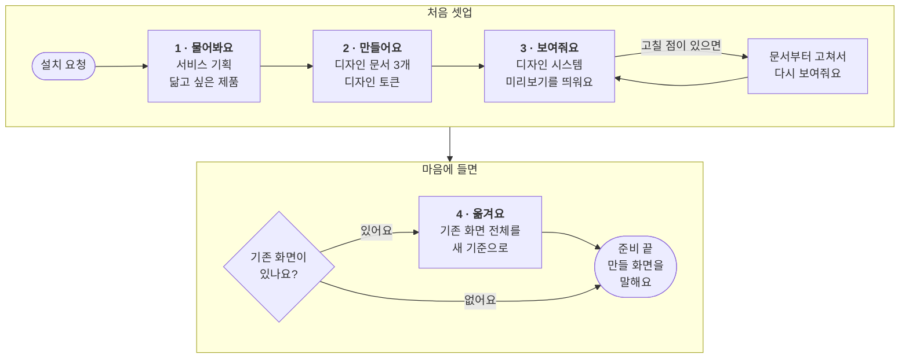

<div align="center">


<h1></h1>

**천재 디자이너 엘리를 팀에 합류시키세요.**

[공식 웹사이트 (준비 중)](https://eli-design.dev) · [Storybook](https://storybook.eli-design.dev) · [컴포넌트 사용 예시](packages/cli/README.md#컴포넌트-사용하기) · [기여 방법](#함께-개발해요)

</div>

디자이너가 없어도, 디자인을 몰라도 괜찮아요. 엘리는 AI 에이전트 안에서 일하는 디자이너예요. 서비스가 무엇인지 듣고, 디자인 방향을 정하고, 화면을 만들 때마다 그 방향을 지켜요. 그래서 AI가 만든 티가 나지 않는, 이 서비스만의 화면이 나와요.

## 시작하는 방법은 한 줄이에요

쓰고 있는 AI 에이전트(Claude Code, Codex)에게 이렇게 말해요.

```text
https://github.com/ELI-team/ELI 를 읽고 이 프로젝트에 ELI를 설치해줘
```

나머지는 에이전트가 이 문서의 [설치 안내](#ai-에이전트가-읽는-설치-안내)를 읽고 진행해요. 엘리가 서비스에 대해 두 가지를 물어보면 답하고, 만들어 준 디자인 시스템을 보고 마음에 들 때까지 고쳐 달라고 하면 돼요.

> **npm에서 설치할 수 있어요.** `eli-design`으로 필요한 컴포넌트 소스를 추가하고, 스킬·훅은 별도 명령으로 선택해요. 공식 홍보 전에는 `0.x`로 관리하고 공식 홍보를 시작할 때 `1.0.0`으로 전환해요. 컴포넌트 문서 서버는 아직 준비 중이에요. 어디까지 되는지는 [지금 되는 것](#지금-되는-것)에 적어 뒀어요.

## 왜 AI가 만든 화면은 티가 날까요

AI는 매번 처음부터 다시 정해요. 그래서 가장 흔한 선택을 반복해요. 어디서 본 듯한 보라색 그라데이션, 화면마다 조금씩 다른 간격, 이유 없이 들어간 아이콘, 버튼마다 다른 말투가 그렇게 생겨요.

엘리는 정한 것을 적어 두고, 매번 그것을 읽고 일해요.

| 흔한 문제 | 엘리가 하는 일 |
| --- | --- |
| 화면마다 색과 간격이 달라요 | 디자인 토큰을 먼저 만들고, 모든 화면이 토큰만 쓰게 해요 |
| 어디서 본 듯한 디자인이에요 | 서비스의 기획과 닮고 싶은 제품을 듣고 `DESIGN.md`에 방향을 정해요 |
| 버튼마다 말투가 달라요 | `UX-WRITING.md`에 말투와 용어를 정하고 모든 문구가 따르게 해요 |
| 아이콘이 제각각이고 너무 많아요 | `ICON.md`에 스타일을 정하고, 꼭 필요한 자리에만 만들어요 |
| 버튼과 입력창을 매번 새로 만들어요 | 필요한 컴포넌트 소스를 추가하고 설치된 로컬 경로에서 가져와요 |
| 모바일에서 깨지고 넘쳐요 | CSS 단위, 레이아웃, 접근성 기준을 지키고 스스로 점검해요 |

## 엘리가 합류하면 이렇게 진행돼요



### 새로 시작하는 프로젝트

엘리가 두 가지만 물어요. 어떤 서비스인지, 그리고 당근이나 토스처럼 닮고 싶은 제품이 무엇인지예요. 답을 바탕으로 디자인 방향, 문구 규칙, 아이콘 스타일을 정하고, 디자인 토큰을 만들어요. 그리고 한 페이지에 모아 내 컴퓨터에서 보여줘요. 보고 고칠 점을 말하면 문서부터 고쳐서 다시 보여줘요.

### 이미 진행 중인 프로젝트

같은 과정을 거친 뒤, 이어서 **기존 화면 전체를 새 기준으로 옮겨요.** 문서만 만들고 옛 화면을 그대로 두면 새 화면과 옛 화면이 따로 놀기 때문이에요.

- 새 브랜치에서 작업해서 언제든 되돌릴 수 있어요.
- 직접 쓴 색과 간격을 토큰으로, 자체 구현을 ELI 컴포넌트로, 문구를 정한 말투로 바꿔요.
- 토큰, 단위, 컴포넌트, 문구, 화면 품질 순서로 나눠 고치고, 한 묶음을 끝낼 때마다 프로젝트의 검사를 실행해요.
- 기능과 로직은 바꾸지 않아요. 화면의 모양과 문구의 표현만 옮겨요.
- 모양이 눈에 띄게 달라지는 변경은 고치기 전에 모아서 물어요.

## 엘리에게 시킬 수 있는 일

명령을 외우지 않아도 돼요. "버튼 색 바꿔줘", "문구 좀 다듬어줘"처럼 말하면 엘리가 정해 둔 기준을 읽고 일해요. 직접 부르고 싶을 때는 아래 명령을 써요.

| 명령 | 하는 일 |
| --- | --- |
| `/eli-setup` | 처음 셋업해요. 묻고, 만들고, 다듬고, 기존 화면을 옮겨요 |
| `/eli-doctor` | 설치와 설정이 올바른지 점검하고 다음에 할 일을 알려줘요 |
| `/eli-design-md` | 서비스 기획과 디자인 방향을 `DESIGN.md`에 정리해요 |
| `/eli-design-system` | 글꼴을 연결하고, 디자인 토큰을 만들고, 디자인 시스템 페이지를 띄워 보여줘요 |
| `/eli-verify` | 기준을 따르지 않는 코드와 깨지기 쉬운 화면을 찾아 고쳐요 |
| `/eli-ux-writing` | 문구 규칙을 정하고 화면의 문구를 다듬어요 |
| `/eli-update` | 쓰는 버전을 확인하고, 새 버전이 있으면 알린 뒤 올려요 |
| `/eli-icon` | 화면의 주인공이 되는 커스텀 아이콘을 같은 톤으로 만들어요 |

엘리가 프로젝트에 만드는 문서는 세 개예요. 모두 프로젝트 루트에 있고 직접 고쳐도 돼요.

| 문서 | 담는 내용 |
| --- | --- |
| `DESIGN.md` | 서비스, 사용자, 닮고 싶은 제품, 디자인 원칙, 글꼴, CSS 단위 기준, 토큰 파일의 위치, 쓰는 버전과 마지막으로 확인한 날짜 |
| `UX-WRITING.md` | 말투, 호칭, 버튼과 오류 문구의 형식, 용어, 표기 |
| `ICON.md` | 커스텀 아이콘을 쓰는 자리, 형태와 색, 지금까지 만든 아이콘 |

## 지금 되는 것

| 기능 | 상태 |
| --- | --- |
| 스킬과 훅 설치 | `eli-design harness`에서 에이전트를 선택해요 |
| `DESIGN.md`, `UX-WRITING.md`, `ICON.md` 만들기 | 돼요 |
| CSS, 접근성, React 코드 기준 지키기 | 돼요 |
| 문구 다듬기, 커스텀 아이콘 만들기 | 돼요 |
| 직접 쓴 색상 값을 고칠 때마다 알려주기 (Claude Code) | 돼요 |
| 버전을 확인한 지 오래되면 알려주기 | 돼요 |
| 새 버전 확인하고 올리기 (`/eli-update`) | 원격 MCP가 준비되면 돼요 |
| 필요한 컴포넌트 소스 추가 | `eli-design add`로 하나·여러 개·전체를 선택해요 |
| 컴포넌트 문서와 토큰 조회 (원격 MCP) | 준비 중이에요. 규격만 정해져 있어요 |
| 디자인 토큰 만들기, 디자인 시스템 페이지, 코드 점검, 기존 화면 옮기기 | 원격 MCP의 문서·토큰 조회가 준비되면 전체 흐름을 사용할 수 있어요 |

준비 중인 단계를 만나면 엘리는 추측해서 진행하지 않고, 할 수 있는 데까지 한 뒤 무엇이 남았는지 알려줘요. 스킬과 훅이 실제 프로젝트에서 처음부터 끝까지 동작하는지는 아직 충분히 확인하지 못했어요.

## AI 에이전트가 읽는 설치 안내

기본 설치는 npm의 `eli-design`을 사용해요. [CLI 사용법](packages/cli/README.md)에 설치 명령과 옵션이 있어요.

1. 사용자의 프로젝트 루트와 요청한 설치 범위를 확인해요. UI와 하네스는 각각 선택해요.
2. UI는 React가 설치된 앱에서 `init` 후 요청한 컴포넌트만 `add`로 추가해요. 전체는 명시적으로 원할 때만 `add --all`을 사용해요.
3. 하네스를 요청했다면 Claude Code·Codex 또는 둘 모두를 선택해 `harness --agent claude|codex|all`을 실행하고 출력된 후속 안내를 따라요. 하네스만 설치할 때 UI init이나 React는 필요하지 않아요.
4. `status --json`과 실제 파일을 대조하고 설치한 것·건너뛴 단계·확인하지 못한 것을 알려요. 원격 MCP 연결은 별도예요.

기존 `@eli-design/ui` 전체 패키지는 종료 예정이에요. 신규 설치는 소스 방식으로 안내하고, 기존 프로젝트는 실제 import와 수정 파일을 확인한 뒤 이전해요. 기존 의존성을 임의로 제거하지 않아요.

## 컴포넌트 사용하기

아래는 게시 대기 중인 CLI 0.3.0과 공개된 UI 콘텐츠 0.2.0의 사용 예시예요. 현재 npm latest는 CLI 0.2.0이며 기존 설치 파일은 자동으로 바뀌지 않아요. [릴리스 상태](handbook/releases/0.3.0.md)를 확인해요.

엘리 없이 직접 사용할 수도 있어요. 기존 React `^19.3.0` 프로젝트에서 실행해요.

```bash
npx eli-design@latest init
npx eli-design@latest add button
```

기본 설치 경로는 `src` 폴더가 있으면 `src/components/ui`, 없으면 `components/ui`예요. 아래는 `src/App.tsx` 기준 예시이며, 실제 import 경로는 설치 결과를 확인해요.

```tsx
import { Button } from './components/ui/button';

export function SaveButton() {
  return <Button icon={null} onClick={() => console.log('저장했어요')}>저장하기</Button>;
}
```

기본 CSS와 공통 토큰은 컴포넌트에 연결돼 있어 별도 CSS import가 필요 없어요. `className`과 `style`로 일반 CSS·CSS Modules·Tailwind CSS·Emotion·vanilla-extract 스타일을 적용할 수 있어요. [스타일 적용 위치·우선순위와 상태별 예시](packages/ui/README.md#컴포넌트-스타일을-바꿔요)를 확인해요. React와 폰트는 소비 앱에서 준비해요.

기존 `@/* → src/*` 별칭을 쓰는 앱에서는 `@/components/ui/button`으로 가져올 수도 있어요. 원하는 설치 위치는 초기화할 때 `--dir`로 지정해요. [CLI 사용법](packages/cli/README.md)을 참고해요.

### 필요한 컴포넌트 선택하기

```bash
npx eli-design@latest list
npx eli-design@latest add modal select
npx eli-design@latest add --all
```

`list`에서 공개 컴포넌트 ID를 확인해요. `add`는 선택한 컴포넌트와 필요한 토큰·아이콘·하위 컴포넌트만 추가하고 같은 공통 파일은 재사용해요. `--all`은 전체 UI 소스를 추가하며 하네스는 포함하지 않아요.

### 하네스 선택하기

```bash
npx eli-design@latest harness --agent claude
npx eli-design@latest harness --agent codex
```

둘 다 사용하면 `--agent all`을 선택해요. 기존 설정을 보존해 훅을 등록하고 `eli.harness.json`에 버전과 설치 파일을 기록해요. Codex는 `/hooks`에서 사용자가 훅을 확인·신뢰해야 해요. 실제 에이전트의 스킬 사용과 원격 MCP 동작은 파일 설치 검사와 별도로 확인해요.

CLI 0.2.0에서 하네스만 설치한 프로젝트는 `status --json`으로 확인해요. 일반 `status` 출력 오류 수정은 [PR #84](https://github.com/ELI-team/ELI/pull/84)로 병합했으며 다음 CLI 0.3.1 후보에 포함돼요. 저장소 이전 수정과 함께 [CLI 0.3.1 검증 파일을 준비](handbook/releases/0.3.1.md)했으며 npm 게시를 기다리고 있어요. 게시된 0.2.0에는 포함되지 않았어요.

### 기존 전체 패키지에서 이전하기

`@eli-design/ui`는 종료 예정이에요. 필요한 소스를 CLI로 추가하고 import를 설치된 로컬 파일로 변경해요. 기존 스타일 수정·기능·하네스 설정을 확인한 뒤 의존성을 정리해요. 단순 문서 수정만으로 기존 앱을 자동 전환하거나 npm 패키지를 삭제하지 않아요. [컴포넌트 예시](packages/ui/README.md)는 소스 설치 기준으로 제공해요.

### 폰트

UI 소스와 기존 전체 패키지는 폰트 파일이나 CDN import를 포함하지 않아요. 패키지 크기와 소비 앱의 폰트 정책을 분리하기 위해서예요. 컴포넌트는 `--eli-font-family-sans` 변수의 글꼴을 쓰고, 이 변수의 기본값은 Pretendard Variable과 시스템 글꼴이에요. ELI의 글자 크기, 줄 높이, 자간은 Pretendard에 맞춰져 있어서 글꼴은 Pretendard로 고정이에요.

[Pretendard 공식 안내](https://github.com/orioncactus/pretendard)의 가변 다이나믹 서브셋을 전역 진입점에서 한 번 불러와요. CLI는 폰트를 자동 설치하지 않아요. 하네스의 셋업 절차로 연결하거나 앱에서 직접 불러와요.

```bash
npm i pretendard
```

```ts
import 'pretendard/dist/web/variable/pretendardvariable-dynamic-subset.css';
```

Next.js의 `next/font/local`로 불러오면 글꼴이 다른 이름으로 등록돼서 ELI 컴포넌트에 적용되지 않아요. 위의 CSS import를 써요.

### 지원 환경

| 영역 | 기준 |
| --- | --- |
| React | `^19.3.0` |
| 모듈 | ESM과 TypeScript 타입 선언 |
| 프레임워크 | Vite, Next.js App Router 소비 검증 |
| 데스크톱 브라우저 | 최신 안정 Chrome, Edge, Safari, Firefox 지원 목표 |
| 모바일 웹 | Android Chrome, iOS Safari 지원 목표 |
| 패키지 매니저 | npm, pnpm, Yarn Classic, Yarn Modern `node-modules`·PnP, Bun |

브라우저 자동 검사는 실제 Chrome·Edge와 Playwright의 Chromium·Firefox·WebKit에서 실행해요. Android와 iOS 조건은 자동 에뮬레이션하며, 실제 기기의 터치·가상 키보드·보조 기술 확인과 구분해요.

## 저장소에서 개발해요

ELI 자체를 개발할 때는 Vite 프로젝트를 따로 만들지 않아요. 저장소를 내려받으면 Storybook과 개발용 React가 함께 설치돼요.

### 필요한 환경

- Node.js `24.21.0`
- pnpm `12.8.1`

```bash
git clone https://github.com/ELI-team/ELI.git
cd ELI
pnpm install --frozen-lockfile
pnpm exec playwright install chromium
pnpm dev
```

Storybook은 `http://localhost:6006`에서 열려요. Node.js와 pnpm 버전은 `.node-version`과 루트 `package.json`에 고정돼 있어요.

### 자주 사용하는 명령

| 명령 | 하는 일 |
| --- | --- |
| `pnpm dev` | Storybook 개발 서버를 실행해요 |
| `pnpm dev:docs` | 문서·랜딩 페이지 Next.js 개발 서버를 실행해요 |
| `pnpm build:docs` | 문서·랜딩 페이지를 프로덕션 빌드해요 |
| `pnpm build` | ESM·타입·CSS 배포 파일을 만들고 하네스를 패키지에 복사해요 |
| `pnpm typecheck` | TypeScript 타입을 확인해요 |
| `pnpm lint` | 코드 규칙을 확인해요 |
| `pnpm test:harness` | 하네스의 훅 출력과 스킬 형식을 확인해요 |
| `pnpm test:packaging` | tarball의 공개 경로·SSR·CSS 연결을 확인해요 |
| `pnpm test:browser` | Chromium에서 상호작용·접근성·계산 스타일을 확인해요 |
| `pnpm test:browsers` | 브라우저 엔진과 모바일 기기 조건을 함께 확인해요 |
| `pnpm test:next` | Next.js App Router 소비 환경을 확인해요 |
| `pnpm test:package-managers` | 지원 패키지 매니저의 설치와 소비 빌드를 확인해요 |
| `pnpm size` | 패키지 압축 크기·압축 해제 크기·파일 수를 기록해요 |
| `pnpm size:cli` | 격리된 HTTP 서버에서 CLI 설치 흐름의 콜드·재실행 응답 본문 크기를 측정해요 |
| `pnpm build:registry` | 선택 설치용 목록·항목별 JSON을 생성해요 |
| `pnpm build:harness` | UI와 별도의 전체 스킬·훅 JSON을 생성해요 |
| `pnpm build:cli` | UI 콘텐츠를 포함하지 않는 설치 도구를 빌드해요 |
| `pnpm test:cli` | 설치 도구 tarball·선택 다운로드·파일 보호를 확인해요 |
| `pnpm test:cli:consumer` | CLI로 추가한 소스의 타입·Vite·Next.js 소비를 확인해요 |
| `pnpm test:cli:package-managers` | 여섯 패키지 매니저 환경의 CLI 실행·소스 소비·lockfile 보존을 확인해요 |
| `pnpm test:registry` | JSON 규격·의존 파일·선택 설치 소스의 소비 빌드를 검증해요 |
| `pnpm check` | 일상 핵심 검증을 순서대로 실행해요 |

전체 검사 범위와 실행 기준은 [검증 지침](Agent/testing.md)에서 확인해요.

### 프로젝트 구조

```text
ELI/
├── Agent/              # 개발·검증·배포 규칙
├── handbook/           # 협업 가이드와 점검 기록
├── apps/docs/          # 문서·랜딩 페이지와 원격 MCP를 제공할 Next.js 앱
├── apps/storybook/     # 컴포넌트 개발·디자인 확인 앱
├── packages/ui/        # 선택 설치·기존 전체 패키지가 공유하는 UI 원본
├── packages/registry/  # 선택 설치 데이터의 생성 정책·JSON 규격
├── packages/cli/       # 선택한 UI 소스를 추가하는 eli-design 실행 도구
├── packages/harness/   # 독립 버전의 스킬·훅과 선택 설치 JSON 규격
├── scripts/            # 빌드와 패키지 검사 도구
└── tests/              # 소비 환경·브라우저·성능·하네스 검사
```

사용자 배포는 CLI를 통한 소스 설치로 통일하며 기존 전체 UI 패키지는 종료 예정이에요. UI 원본과 현재 내부 workspace 연결은 유지하고 하네스는 독립 콘텐츠로 선택 설치해요. Storybook과 테스트 도구는 배포 패키지에 포함하지 않아요. 엘리의 스킬과 훅은 [하네스 지침](Agent/harness.md), 원격 MCP는 [원격 MCP 규격](Agent/mcp-spec.md), 전체 구조는 [프로젝트 구조 지침](Agent/architecture.md)에서 확인해요.

## 로드맵

다음 기능은 아직 구현되지 않았어요.

- npm 게시 자동화
- 컴포넌트 문서와 토큰을 제공하는 원격 MCP 서버
- 사용자용 문서 사이트와 한글 가이드
- 버전을 올릴 때 바뀐 API를 찾아 주는 업그레이드 안내

예정된 기능을 현재 사용할 수 있는 기능처럼 안내하지 않아요. 논의 중인 개선안은 [개선 제안](handbook/improvements.md)에서 확인할 수 있어요.

## 함께 개발해요

1. [AGENTS.md](AGENTS.md)에서 작업에 맞는 지침을 확인해요.
2. 최신 `main`에서 목적에 맞는 브랜치를 만들어요.
3. 변경 위험도에 맞는 검증을 실행해요.
4. 한국어 Conventional Commit과 PR 규칙을 따라요.

세부 절차는 [Git 규칙](Agent/branch.md), 컴포넌트 구현은 [컴포넌트 지침](Agent/components.md), 디자인 전달은 [디자이너 협업 가이드](handbook/designer-guide.md)를 참고해요.

미배포 변경은 [CHANGELOG](CHANGELOG.md)의 `Unreleased`에 기록하고 릴리스 준비 때 대상별 구역으로 옮겨요. 게시된 CLI 0.2.0의 기록은 [기존 릴리스](handbook/releases/0.2.0.md), 공개된 UI 콘텐츠 0.2.0과 게시 대기 중인 CLI 0.3.0의 고정 파일·검증 범위는 [새 릴리스](handbook/releases/0.3.0.md)에서 확인해요. 미배포 하네스 문서는 이번 후보에 포함하지 않아요. 버전 증가 정책은 [버전 규칙](Agent/versioning.md), 실제 게시·확인·복구 순서는 [릴리스 절차](handbook/releasing.md)에서 관리해요. npm 담당자는 [게시 안내](handbook/npm-publishing.md)에 따라 검증된 파일의 게시와 태그 변경만 맡아요. 일반 PR 병합으로 npm 버전이 자동 갱신되지는 않아요.

## 라이선스

ELI의 코드와 문서는 [MIT 라이선스](LICENSE)예요. 상업적 사용, 수정, 재배포가 모두 가능해요.

ELI의 이름, 로고, 마스코트 캐릭터 "엘리"는 MIT 라이선스의 대상이 아니에요. 사용 기준은 [브랜드 사용 안내](TRADEMARKS.md)에서 확인해요.
