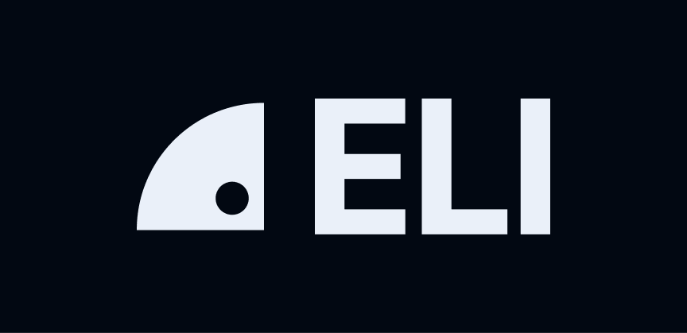
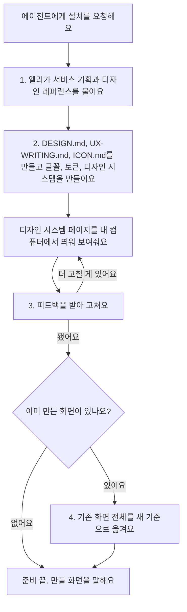

<div align="center">


<h1></h1>

**천재 디자이너 엘리를 팀에 합류시키세요.**

공식 문서 보기 (준비 중) · [컴포넌트 사용 예시](packages/ui/README.md) · [기여 방법](#함께-개발해요)

</div>

디자이너가 없어도, 디자인을 몰라도 괜찮아요. 엘리는 AI 에이전트 안에서 일하는 디자이너예요. 서비스가 무엇인지 듣고, 디자인 방향을 정하고, 화면을 만들 때마다 그 방향을 지켜요. 그래서 AI가 만든 티가 나지 않는, 이 서비스만의 화면이 나와요.

## 시작하는 방법은 한 줄이에요

쓰고 있는 AI 에이전트(Claude Code, Codex)에게 이렇게 말해요.

```text
https://github.com/ELI-LDS/ELI 를 읽고 이 프로젝트에 ELI를 설치해줘
```

나머지는 에이전트가 이 문서의 [설치 안내](#ai-에이전트가-읽는-설치-안내)를 읽고 진행해요. 엘리가 서비스에 대해 두 가지를 물어보면 답하고, 만들어 준 디자인 시스템을 보고 마음에 들 때까지 고쳐 달라고 하면 돼요.

> **개발 중이에요.** 엘리의 스킬과 훅은 지금 설치해서 쓸 수 있어요. 컴포넌트 패키지 `@eli-design/ui`의 npm 게시와 컴포넌트 문서 서버는 아직 준비 중이라, 지금은 일부 단계까지만 진행돼요. 어디까지 되는지는 [지금 되는 것](#지금-되는-것)에 적어 뒀어요.

## 왜 AI가 만든 화면은 티가 날까요

AI는 매번 처음부터 다시 정해요. 그래서 가장 흔한 선택을 반복해요. 어디서 본 듯한 보라색 그라데이션, 화면마다 조금씩 다른 간격, 이유 없이 들어간 아이콘, 버튼마다 다른 말투가 그렇게 생겨요.

엘리는 정한 것을 적어 두고, 매번 그것을 읽고 일해요.

| 흔한 문제 | 엘리가 하는 일 |
| --- | --- |
| 화면마다 색과 간격이 달라요 | 디자인 토큰을 먼저 만들고, 모든 화면이 토큰만 쓰게 해요 |
| 어디서 본 듯한 디자인이에요 | 서비스의 기획과 닮고 싶은 제품을 듣고 `DESIGN.md`에 방향을 정해요 |
| 어디서나 보는 기본 글꼴이에요 | 상업적으로 쓸 수 있고 흔하지 않은 글꼴 후보를 화면으로 보여주고 고르게 해요 |
| 버튼마다 말투가 달라요 | `UX-WRITING.md`에 말투와 용어를 정하고 모든 문구가 따르게 해요 |
| 아이콘이 제각각이고 너무 많아요 | `ICON.md`에 스타일을 정하고, 꼭 필요한 자리에만 만들어요 |
| 버튼과 입력창을 매번 새로 만들어요 | 검증된 컴포넌트 `@eli-design/ui`를 문서를 읽고 정확하게 써요 |
| 모바일에서 깨지고 넘쳐요 | CSS 단위, 레이아웃, 접근성 기준을 지키고 스스로 점검해요 |

## 엘리가 합류하면 이렇게 진행돼요



### 새로 시작하는 프로젝트

엘리가 두 가지만 물어요. 어떤 서비스인지, 그리고 당근이나 토스처럼 닮고 싶은 제품이 무엇인지예요. 답을 바탕으로 디자인 방향, 문구 규칙, 아이콘 스타일을 정하고, 서비스에 맞는 글꼴을 골라 적용하고, 디자인 토큰을 만들어요. 그리고 한 페이지에 모아 내 컴퓨터에서 보여줘요. 보고 고칠 점을 말하면 문서부터 고쳐서 다시 보여줘요.

### 이미 진행 중인 프로젝트

같은 과정을 거친 뒤, 이어서 **기존 화면 전체를 새 기준으로 옮겨요.** 문서만 만들고 옛 화면을 그대로 두면 새 화면과 옛 화면이 따로 놀기 때문이에요.

- 새 브랜치에서 작업해서 언제든 되돌릴 수 있어요.
- 직접 쓴 색과 간격을 토큰으로, 자체 구현을 ELI 컴포넌트로, 문구를 정한 말투로 바꿔요.
- 토큰, 단위, 컴포넌트, 문구, 화면 품질 순서로 나눠 고치고, 한 묶음을 끝낼 때마다 프로젝트의 검사를 실행해요.
- 기능과 로직은 바꾸지 않아요. 화면의 모양과 문구의 표현만 옮겨요.
- 모양이 눈에 띄게 달라지는 변경은 고치기 전에 모아서 물어요.

## 엘리에게 시킬 수 있는 일

명령을 외우지 않아도 돼요. "버튼 색 바꿔줘", "문구 좀 다듬어줘"처럼 말하면 엘리가 정해 둔 기준을 읽고 일해요. 직접 부르고 싶을 때는 아래 명령을 써요.

| 명령 | 하는 일 |
| --- | --- |
| `/eli-setup` | 처음 셋업해요. 묻고, 만들고, 다듬고, 기존 화면을 옮겨요 |
| `/eli-doctor` | 설치와 설정이 올바른지 점검하고 다음에 할 일을 알려줘요 |
| `/eli-design-md` | 서비스 기획과 디자인 방향을 `DESIGN.md`에 정리해요 |
| `/eli-design-system` | 글꼴을 고르고, 디자인 토큰을 만들고, 디자인 시스템 페이지를 띄워 보여줘요 |
| `/eli-verify` | 기준을 따르지 않는 코드와 깨지기 쉬운 화면을 찾아 고쳐요 |
| `/eli-ux-writing` | 문구 규칙을 정하고 화면의 문구를 다듬어요 |
| `/eli-update` | 쓰는 버전을 확인하고, 새 버전이 있으면 알린 뒤 올려요 |
| `/eli-icon` | 화면의 주인공이 되는 커스텀 아이콘을 같은 톤으로 만들어요 |

엘리가 프로젝트에 만드는 문서는 세 개예요. 모두 프로젝트 루트에 있고 직접 고쳐도 돼요.

| 문서 | 담는 내용 |
| --- | --- |
| `DESIGN.md` | 서비스, 사용자, 닮고 싶은 제품, 디자인 원칙, 글꼴, CSS 단위 기준, 토큰 파일의 위치, 쓰는 버전과 마지막으로 확인한 날짜 |
| `UX-WRITING.md` | 말투, 호칭, 버튼과 오류 문구의 형식, 용어, 표기 |
| `ICON.md` | 커스텀 아이콘을 쓰는 자리, 형태와 색, 지금까지 만든 아이콘 |

## 지금 되는 것

| 기능 | 상태 |
| --- | --- |
| 스킬과 훅 설치 | 돼요. npm 게시 전에는 저장소를 받아서 설치해요 |
| `DESIGN.md`, `UX-WRITING.md`, `ICON.md` 만들기 | 돼요 |
| CSS, 접근성, React 코드 기준 지키기 | 돼요 |
| 문구 다듬기, 커스텀 아이콘 만들기 | 돼요 |
| 직접 쓴 색상 값을 고칠 때마다 알려주기 (Claude Code) | 돼요 |
| 버전을 확인한 지 오래되면 알려주기 | 돼요 |
| 새 버전 확인하고 올리기 (`/eli-update`) | 원격 MCP가 준비되면 돼요 |
| `@eli-design/ui` 컴포넌트 설치 | 준비 중이에요. npm에 아직 게시하지 않았어요 |
| 컴포넌트 문서와 토큰 조회 (원격 MCP) | 준비 중이에요. 규격만 정해져 있어요 |
| 디자인 토큰 만들기, 디자인 시스템 페이지, 코드 점검, 기존 화면 옮기기 | 위 두 가지가 준비되면 돼요 |

준비 중인 단계를 만나면 엘리는 추측해서 진행하지 않고, 할 수 있는 데까지 한 뒤 무엇이 남았는지 알려줘요. 스킬과 훅이 실제 프로젝트에서 처음부터 끝까지 동작하는지는 아직 충분히 확인하지 못했어요.

## AI 에이전트가 읽는 설치 안내

이 섹션은 사용자가 이 저장소의 링크를 주고 설치를 요청했을 때 AI 에이전트가 읽고 실행해요. 엘리의 스킬과 훅은 `@eli-design/ui` 패키지에 함께 들어 있어요.

1. 지금 폴더가 사용자의 프로젝트 루트인지 확인해요. `package.json`이 없으면 어디에 설치할지 물어요.
2. 프로젝트의 패키지 매니저로 `@eli-design/ui`를 설치해요. 이미 설치되어 있으면 건너뛰어요.
3. `node_modules/@eli-design/ui/harness/INSTALL.md`를 읽고 그 순서대로 진행해요. 스킬 복사, 훅 등록, 셋업 시작이 모두 그 문서에 있어요.
4. 설치한 것, 건너뛴 단계와 그 이유, 확인하지 못한 것을 사용자에게 알려요.

**2번이 실패하면:** `@eli-design/ui`는 아직 npm에 게시하지 않았어요. 설치할 수 없으면 사용자에게 알리고, 계속할지 물어요. 계속하면 저장소를 사용자의 프로젝트 밖 임시 폴더에 받아 `packages/harness/INSTALL.md`를 따라요. 이 경우 스킬과 훅만 설치되고 컴포넌트는 설치되지 않아요.

```bash
git clone --depth 1 https://github.com/ELI-LDS/ELI.git <임시 폴더>/eli
```

저장소의 소스를 프로젝트에 복사해서 컴포넌트를 대신 설치하지 않아요. 설치하지 않은 것을 설치했다고 적지 않아요.

## 컴포넌트 라이브러리 `@eli-design/ui`

엘리가 화면을 만들 때 쓰는 React 컴포넌트예요. 에이전트 없이 직접 써도 돼요.

- 컴포넌트만 import하면 기본 CSS와 디자인 토큰이 함께 연결돼요.
- 엘리의 스킬과 훅이 패키지에 함께 들어 있어요. 컴포넌트와 항상 같은 버전이에요.
- `@eli-design/ui/button`처럼 역할별 경로에서 필요한 컴포넌트를 가져와요.
- `className`과 `style`로 일반 CSS, CSS Modules, Tailwind CSS, Emotion, vanilla-extract 스타일을 적용할 수 있어요.
- Vite와 Next.js App Router의 빌드·SSR·hydration을 실제 패키지 tarball로 확인해요.
- React를 패키지에 중복해서 넣지 않고 소비 앱의 React를 peer dependency로 공유해요.

컴포넌트의 모양과 사용법은 공식 문서에서 안내할 예정이에요. 공식 문서는 아직 준비 중이에요.

### 설치 명령은 npm 게시 후 사용할 수 있어요

현재 버전은 `0.0.0`이며 npm에는 아직 게시하지 않았어요. 게시하면 사용하는 패키지 매니저에 맞춰 하나의 명령만 실행해요.

```bash
# npm
npm install @eli-design/ui

# pnpm
pnpm add @eli-design/ui

# Yarn
yarn add @eli-design/ui

# Bun
bun add @eli-design/ui
```

ELI는 React `^19.3.0`을 peer dependency로 사용해요. 기존 React 프로젝트라면 React를 다시 설치할 필요가 없어요.

### 컴포넌트를 사용해요

```tsx
import { Button } from '@eli-design/ui/button';

export function SaveButton() {
  return (
    <Button icon={null} onClick={() => console.log('저장했어요')}>
      저장하기
    </Button>
  );
}
```

별도의 ELI CSS 파일을 import하지 않아도 Button의 기본 스타일과 공통 토큰이 함께 연결돼요. 스타일을 덮어쓰는 방법과 더 많은 예시는 [`@eli-design/ui` 패키지 안내](packages/ui/README.md)에서 확인해요.

### 제공하는 컴포넌트

공개 import 경로는 다음과 같아요. 각 경로의 최신 props는 에디터의 JSDoc에서 확인해요. 공식 문서가 열리면 그곳에서도 안내해요.

| 가져오는 경로 | 컴포넌트 |
| --- | --- |
| `@eli-design/ui/alert` | `Alert` |
| `@eli-design/ui/badge` | `Badge` |
| `@eli-design/ui/button` | `Button`, `IconButton` |
| `@eli-design/ui/checkbox` | `Checkbox` |
| `@eli-design/ui/chip` | `Chip`, `FilterChip`, `RemovableChip` |
| `@eli-design/ui/divider` | `Divider` |
| `@eli-design/ui/fab` | `Fab`, `FabMenu`, `FabMenuSegment` |
| `@eli-design/ui/loading` | `LoadingIndicator`, `ProgressIndicator` |
| `@eli-design/ui/menu` | `MenuItem` |
| `@eli-design/ui/modal` | `Modal` |
| `@eli-design/ui/navigation` | `NavigationBar`, `NavigationBarItem`, `NavigationBarGlass`, `NavigationBarGlassItem`, `NavigationDrawer`, `NavigationDrawerCategory`, `NavigationDrawerMenu`, `NavigationDrawerItem` |
| `@eli-design/ui/radio` | `Radio` |
| `@eli-design/ui/segment-control` | `SegmentControl` |
| `@eli-design/ui/select` | `Select` |
| `@eli-design/ui/slider` | `Slider` |
| `@eli-design/ui/snackbar` | `SnackBar` |
| `@eli-design/ui/tab` | `Tab` |
| `@eli-design/ui/text` | `TextField`, `TextArea` |
| `@eli-design/ui/toggle` | `Toggle` |
| `@eli-design/ui/tooltip` | `Tooltip` |

Modal의 최종 최대 너비는 디자인 확정을 기다리고 있어요. 확정되지 않은 값을 임의로 공개 계약으로 만들지 않아요.

### 폰트

`@eli-design/ui`는 폰트 파일이나 CDN import를 포함하지 않아요. 패키지 크기와 소비 앱의 폰트 정책을 분리하기 위해서예요. 컴포넌트는 `--eli-font-family-sans` 변수의 글꼴을 쓰고, 이 변수의 기본값은 Pretendard Variable과 시스템 글꼴이에요. 엘리와 함께 쓰면 서비스에 맞는 글꼴을 골라 이 변수를 그 글꼴로 바꿔요.

### 지원 환경

| 영역 | 기준 |
| --- | --- |
| React | `^19.3.0` |
| 모듈 | ESM과 TypeScript 타입 선언 |
| 프레임워크 | Vite, Next.js App Router 소비 검증 |
| 데스크톱 브라우저 | 최신 안정 Chrome, Edge, Safari, Firefox 지원 목표 |
| 모바일 웹 | Android Chrome, iOS Safari 지원 목표 |
| 패키지 매니저 | npm, pnpm, Yarn Classic, Yarn Modern `node-modules`·PnP, Bun |

브라우저 자동 검사는 실제 Chrome·Edge와 Playwright의 Chromium·Firefox·WebKit에서 실행해요. Android와 iOS 조건은 자동 에뮬레이션하며, 실제 기기의 터치·가상 키보드·보조 기술 확인과 구분해요.

## 저장소에서 개발해요

ELI 자체를 개발할 때는 Vite 프로젝트를 따로 만들지 않아요. 저장소를 내려받으면 Storybook과 개발용 React가 함께 설치돼요.

### 필요한 환경

- Node.js `24.21.0`
- pnpm `12.8.1`

```bash
git clone https://github.com/ELI-LDS/ELI.git
cd ELI
pnpm install --frozen-lockfile
pnpm exec playwright install chromium
pnpm dev
```

Storybook은 `http://localhost:6006`에서 열려요. Node.js와 pnpm 버전은 `.node-version`과 루트 `package.json`에 고정돼 있어요.

### 자주 사용하는 명령

| 명령 | 하는 일 |
| --- | --- |
| `pnpm dev` | Storybook 개발 서버를 실행해요 |
| `pnpm dev:docs` | 문서·랜딩 페이지 Next.js 개발 서버를 실행해요 |
| `pnpm build:docs` | 문서·랜딩 페이지를 프로덕션 빌드해요 |
| `pnpm build` | ESM·타입·CSS 배포 파일을 만들고 하네스를 패키지에 복사해요 |
| `pnpm typecheck` | TypeScript 타입을 확인해요 |
| `pnpm lint` | 코드 규칙을 확인해요 |
| `pnpm test:harness` | 하네스의 훅 출력과 스킬 형식을 확인해요 |
| `pnpm test:packaging` | tarball의 공개 경로·SSR·CSS 연결을 확인해요 |
| `pnpm test:browser` | Chromium에서 상호작용·접근성·계산 스타일을 확인해요 |
| `pnpm test:browsers` | 브라우저 엔진과 모바일 기기 조건을 함께 확인해요 |
| `pnpm test:next` | Next.js App Router 소비 환경을 확인해요 |
| `pnpm test:package-managers` | 지원 패키지 매니저의 설치와 소비 빌드를 확인해요 |
| `pnpm size` | 패키지 압축 크기·압축 해제 크기·파일 수를 기록해요 |
| `pnpm check` | 일상 핵심 검증을 순서대로 실행해요 |

전체 검사 범위와 실행 기준은 [검증 지침](Agent/testing.md)에서 확인해요.

### 프로젝트 구조

```text
ELI/
├── Agent/              # 개발·검증·배포 규칙
├── handbook/           # 협업 가이드와 점검 기록
├── apps/docs/          # 문서·랜딩 페이지와 원격 MCP를 제공할 Next.js 앱
├── apps/storybook/     # 컴포넌트 개발·디자인 확인 앱
├── packages/ui/        # 배포할 @eli-design/ui 소스
├── packages/harness/   # 엘리의 스킬과 훅. 빌드할 때 @eli-design/ui에 함께 들어가요
├── scripts/            # 빌드와 패키지 검사 도구
└── tests/              # 소비 환경·브라우저·성능·하네스 검사
```

`packages/ui`를 `@eli-design/ui`로 배포하고, `packages/harness`의 스킬과 훅이 그 패키지에 함께 들어가요. Storybook과 테스트 도구는 배포 패키지에 포함하지 않아요. 엘리의 스킬과 훅은 [하네스 지침](Agent/harness.md), 원격 MCP는 [원격 MCP 규격](Agent/mcp-spec.md), 전체 구조는 [프로젝트 구조 지침](Agent/architecture.md)에서 확인해요.

## 로드맵

다음 기능은 아직 구현되지 않았어요.

- `@eli-design/ui`의 npm 게시와 자동 배포
- 컴포넌트 문서와 토큰을 제공하는 원격 MCP 서버
- 사용자용 문서 사이트와 한글 가이드
- 원하는 컴포넌트와 필요한 토큰만 소스로 추가하는 레지스트리·CLI
- 버전을 올릴 때 바뀐 API를 찾아 주는 업그레이드 안내

예정된 기능을 현재 사용할 수 있는 기능처럼 안내하지 않아요. 논의 중인 개선안은 [개선 제안](handbook/improvements.md)에서 확인할 수 있어요.

## 함께 개발해요

1. [AGENTS.md](AGENTS.md)에서 작업에 맞는 지침을 확인해요.
2. 최신 `main`에서 목적에 맞는 브랜치를 만들어요.
3. 변경 위험도에 맞는 검증을 실행해요.
4. 한국어 Conventional Commit과 PR 규칙을 따라요.

세부 절차는 [Git 규칙](Agent/branch.md), 컴포넌트 구현은 [컴포넌트 지침](Agent/components.md), 디자인 전달은 [디자이너 협업 가이드](handbook/designer-guide.md)를 참고해요.

## 라이선스

ELI의 코드와 문서는 [MIT 라이선스](LICENSE)예요. 상업적 사용, 수정, 재배포가 모두 가능해요.

ELI의 이름, 로고, 마스코트 캐릭터 "엘리"는 MIT 라이선스의 대상이 아니에요. 사용 기준은 [브랜드 사용 안내](TRADEMARKS.md)에서 확인해요.
